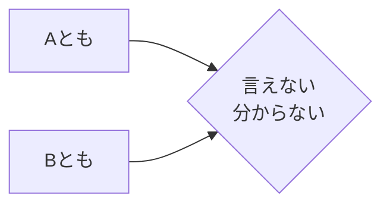

Processing keyword: A とも B とも (A tomo B tomo)
# Điểm ngữ pháp tiếng Nhật: A とも B とも (A tomo B tomo)

## 1. Giới thiệu
Trong tiếng Nhật, việc diễn đạt sự không chắc chắn hoặc mơ hồ thường là cần thiết, đặc biệt khi bạn không thể xác định hoặc phân loại rõ ràng một điều gì đó. Điểm ngữ pháp **AともBとも** được dùng để truyền đạt rằng một điều gì đó không thể được gán nhãn dứt khoát là A hay B. Cấu trúc này đặc biệt hữu ích để diễn đạt các ý kiến hoặc nhận xét tinh tế.

---
## 2. Giải thích ngữ pháp cốt lõi
### Ý nghĩa
**AともBとも** được dịch là "**Không phải A cũng không phải B**" hoặc "**Không thể nói là A hay B**". Nó được dùng khi người nói không thể khẳng định dứt khoát rằng một điều gì đó là A hay B, làm nổi bật sự không chắc chắn hoặc thiếu quyết đoán.
### Cấu trúc
Cấu trúc cơ bản của điểm ngữ pháp này là:
```
[A] とも [B] とも + 言えない／分からない／決められない／判断できない
```
- **A** và **B** thường là tính từ, động từ ở dạng thông thường, hoặc danh từ.
- Thường được theo sau bởi các động từ như **言えない** (không thể nói), **分からない** (không biết), hoặc **判断できない** (không thể phán đoán).
### Sơ đồ hình thành
| **Thành phần**               |                **Giải thích**                |
| --------------------------- | :-------------------------------------------: |
| Aとも                       |    "ngay cả A" (hàm ý không dứt khoát là A)     |
| Bとも                       |    "ngay cả B" (hàm ý không dứt khoát là B)     |
| 言えない／分からない etc.    | Diễn đạt sự không thể quyết định hoặc xác định |
### Minh họa

---
## 3. Phân tích so sánh
### Các điểm ngữ pháp tương tự
- **AでもBでもない**: Trực tiếp có nghĩa là "không phải A cũng không phải B". Được dùng để khẳng định rằng một điều gì đó không phải là A cũng không phải là B.
  - *Ví dụ*: 彼は学生でも先生でもない。 (Anh ấy không phải là học sinh cũng không phải là giáo viên.)
**So sánh**:
- **AともBとも言えない** hàm ý sự không chắc chắn hoặc không thể phân loại, trong khi **AでもBでもない** khẳng định dứt khoát rằng một điều gì đó không phải là A cũng không phải là B.
---
## 4. Ví dụ trong ngữ cảnh
### Ví dụ 1
**Câu**:
- 彼の表情は嬉しいとも悲しいとも判断できない。
**Cách đọc**:
- かれの ひょうじょう は うれしい とも かなしい とも はんだん できない。
**Bản dịch**:
- "Tôi không thể xác định được biểu cảm của anh ấy là vui hay buồn."
### Ví dụ 2
**Câu**:
- その映画は面白いともつまらないとも言えない。
**Cách đọc**:
- その えいが は おもしろい とも つまらない とも いえない。
**Bản dịch**:
- "Tôi không thể nói bộ phim đó thú vị hay nhàm chán."
### Ví dụ 3
**Câu**:
- この料理は美味しいとも美味しくないとも言えない味だ。
**Cách đọc**:
- この りょうり は おいしい とも おいしくない とも いえない あじ だ。
**Bản dịch**:
- "Món ăn này có vị mà tôi không thể nói là ngon hay không ngon."
### Ví dụ 4 (Ngữ cảnh trang trọng)
**Câu**:
- 結果は成功とも失敗とも申せません。
**Cách đọc**:
- けっか は せいこう とも しっぱい とも もうせません。
**Bản dịch**:
- "Tôi không thể nói kết quả là thành công hay thất bại."
---
## 5. Ghi chú văn hóa
### Tính liên quan văn hóa
Trong giao tiếp tiếng Nhật, việc diễn đạt sự không chắc chắn hoặc tránh các câu nói trực tiếp là điều phổ biến, đặc biệt để duy trì sự hòa hợp và tránh xung đột. Việc dùng **AともBとも** cho phép người nói truyền đạt sự mơ hồ một cách lịch sự.
### Mức độ lịch sự
- Các động từ theo sau **AともBとも** có thể được điều chỉnh theo mức độ lịch sự:
  - Thân mật: 言えない (không thể nói)
  - Lịch sự: 言えません (không thể nói)
  - Khiêm nhường/Trang trọng: 申せません (không thể nói - dạng khiêm nhường)
---
## 6. Lỗi thường gặp và mẹo
### Phân tích lỗi
- **Lỗi**: Dùng **AともBとも** chỉ với một lựa chọn.
  - *Sai*: 彼は行くとも言えない。
  - *Đúng*: 彼は行くとも行かないとも言えない。
- **Lỗi**: Quên thêm động từ diễn đạt sự không chắc chắn.
  - *Sai*: 天気は晴れとも雨とも。
  - *Đúng*: 天気は晴れとも雨とも分からない。
### Chiến lược học tập
- **Mẹo ghi nhớ**: Hãy nhớ rằng **とも** lặp lại sau cả A và B để nhấn mạnh sự không chắc chắn về cả hai lựa chọn.
- **Mẹo**: Ghép **AともBとも** với các động từ như **言えない**, **判断できない**, **分からない** để hoàn thành cách diễn đạt.
---
## 7. Tóm tắt và ôn tập
### Những điểm chính
- **AともBとも** được dùng để diễn đạt rằng một điều gì đó không thể được xác định rõ ràng là A hay B.
- Nó nhấn mạnh sự không chắc chắn hoặc không thể đưa ra phán đoán dứt khoát.
- Thường được theo sau bởi các động từ diễn đạt sự không thể quyết định, như **言えない** hoặc **分からない**.
- Phản ánh phong cách giao tiếp của người Nhật trong việc diễn đạt sự mơ hồ một cách lịch sự.
### Bài kiểm tra nhanh
1. **Điền vào chỗ trống**: その答えは正しいとも間違っているとも ______。
   - **Đáp án**: 言えない
2. **Đúng hay Sai**: Cấu trúc **AともBとも** có thể được dùng để khẳng định dứt khoát rằng một điều gì đó không phải là A cũng không phải là B.
   - **Đáp án**: Sai (Nó diễn đạt sự không chắc chắn, không phải một khẳng định dứt khoát.)
3. **Chọn động từ đúng**: 天気が良いとも悪いとも ______。
   - a) 思う
   - b) 分からない
   - c) 決めた
   - **Đáp án**: b) 分からない
---
Hãy thoải mái xem lại các ví dụ và giải thích để củng cố hiểu biết của bạn về **AともBとも**. Hãy luyện tập bằng cách tự đặt câu dùng điểm ngữ pháp này!


---

© [Hoangchamchi.org](https://hoangchamchi.org)