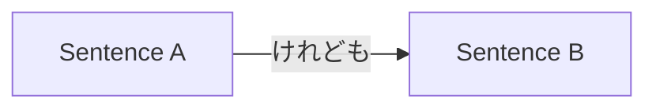

Processing keyword: A。けれども、～B。(A. Keredomo,~ B.)
# Điểm ngữ pháp tiếng Nhật: A。けれども、～B。(A. Keredomo,~ B.)


---
## 1. Giới thiệu
Trong bài học này, chúng ta sẽ tìm hiểu điểm ngữ pháp tiếng Nhật **A。けれども、～B。**, được dùng để nối hai câu nói trong đó câu thứ hai tương phản với hoặc đưa ra một ngoại lệ cho câu thứ nhất. Hiểu cách dùng **けれども** sẽ nâng cao khả năng diễn đạt các ý tưởng tương phản của bạn, giống như "tuy nhiên" hoặc "nhưng" trong tiếng Việt.

---
## 2. Giải thích ngữ pháp cốt lõi
### Ý nghĩa
**けれども** là một liên từ có nghĩa là **"nhưng"**, **"tuy nhiên"**, hoặc **"mặc dù"**. Nó được dùng để nối hai câu trong đó câu thứ hai đưa ra sự tương phản, mâu thuẫn hoặc kết quả bất ngờ so với câu thứ nhất.
### Cấu trúc
Cấu trúc dùng **けれども** trong mẫu câu này như sau:
```
A。けれども、B。
```
- **A**: Một câu hoàn chỉnh kết thúc bằng dạng thông thường.
- **けれども**: Liên từ mang nghĩa "tuy nhiên" hoặc "nhưng".
- **B**: Câu nói tương phản.
### Sơ đồ hình thành
| **Dạng**       | **Ví dụ**                           |
|----------------|---------------------------------------|
| **Câu A** | 明日は雨が降るらしい。                 |
| **けれども**   | けれども、                              |
| **Câu B** | 試合は中止にならない。                 |
| **Câu hoàn chỉnh** | 明日は雨が降るらしい。けれども、試合は中止にならない。 |
### Giải thích chi tiết
- **Câu A** kết thúc bằng dạng thông thường (có thể là thì hiện tại hoặc quá khứ).
- **けれども** có thể được dùng ở đầu một câu mới để thể hiện sự tương phản.
- **Câu B** đưa ra một tình huống tương phản với điều được mong đợi từ Câu A.
### Minh họa: Sơ đồ dòng chảy

---
## 3. Phân tích so sánh
**けれども** so với các liên từ tương phản khác:
| **Liên từ** | **Cách dùng**                       | **Mức độ lịch sự** |
|-----------------|---------------------------------|----------------------|
| けれども         | Hội thoại, văn viết         | Trung tính              |
| が               | Văn viết trang trọng, lời nói lịch sự   | Lịch sự               |
| でも             | Hội thoại, ở đầu B   | Thân mật               |
| しかし           | Trang trọng, văn viết                | Trang trọng               |
| だけど           | Lời nói thân mật                   | Thân mật               |
**Ví dụ so sánh:**
- **けれども**: 雨が降っています。けれども、出かけます。
- **が**: 雨が降っていますが、出かけます。
- **でも**: 雨が降っています。でも、出かけます。
- **しかし**: 雨が降っています。しかし、出かけます。
- **だけど**: 雨が降っています。だけど、出かけます。
---
## 4. Ví dụ trong ngữ cảnh
### Ví dụ 1: Ngữ cảnh trang trọng
**Tiếng Nhật:** 新しいパソコンを買いました。けれども、使い方がよく分かりません。
**Romaji:** Atarashii pasokon o kaimashita. Keredomo, tsukaikata ga yoku wakarimasen.
**Bản dịch:** Tôi đã mua một chiếc máy tính mới. Tuy nhiên, tôi không hiểu rõ cách sử dụng.

---
### Ví dụ 2: Lời nói thân mật
**Tiếng Nhật:** 昨日勉強した。けれども、テストに合格できなかった。
**Romaji:** Kinō benkyō shita. Keredomo, tesuto ni gōkaku dekinakatta.
**Bản dịch:** Hôm qua tôi đã học. Nhưng tôi không thể đậu bài kiểm tra.

---
### Ví dụ 3: Diễn đạt kết quả bất ngờ
**Tiếng Nhật:** この道は近い。けれども、危険だ。
**Romaji:** Kono michi wa chikai. Keredomo, kiken da.
**Bản dịch:** Con đường này ngắn. Tuy nhiên, nó nguy hiểm.

---
### Ví dụ 4: Giao tiếp bằng văn bản
**Tiếng Nhật:** 提案を送りました。けれども、ご返事をいただいておりません。
**Romaji:** Teian o okurimashita. Keredomo, gohenji o itadaite orimasen.
**Bản dịch:** Tôi đã gửi đề xuất. Tuy nhiên, tôi chưa nhận được hồi âm.

---
## 5. Ghi chú văn hóa
### Mức độ lịch sự
- **けれども** được xem là trung tính và có thể được dùng trong cả ngữ cảnh trang trọng lẫn thân mật.
- Trong văn viết hoặc bài phát biểu rất trang trọng, **しかし** hoặc **が** có thể được ưa chuộng hơn.
- Trong hội thoại thân mật, các dạng ngắn hơn như **けど** hoặc **だけど** thường được dùng.
### Các cụm từ thành ngữ
- **とはいえけれども**: Có nghĩa là "Nói vậy nhưng, tuy nhiên..." Được dùng để thừa nhận một điểm nhưng đưa ra sự tương phản.

---
## 6. Lỗi thường gặp và mẹo
### Lỗi thường gặp 1: Dùng sai liên từ
- **Lỗi:** Dùng **けれども** trong văn viết rất trang trọng nơi **しかし** phù hợp hơn.
- **Mẹo:** Hãy nhớ rằng **けれども** trung tính; với văn viết trang trọng, hãy cân nhắc dùng **しかし**.
### Lỗi thường gặp 2: Đặt sai vị trí
- **Lỗi:** Đặt **けれども** ở cuối Câu A mà không có dấu chấm câu.
  - **Sai:** 新しい靴を買ったけれども、サイズが合わない。
  - (Câu này đúng trong tiếng Nhật nói nhưng không theo mẫu **A。けれども、B。**.)
- **Mẹo:** Đảm bảo Câu A kết thúc bằng dấu chấm khi dùng mẫu câu này.
### Chiến lược học tập
- **Mẹo ghi nhớ:** Hãy nghĩ **けれども** như một cây cầu nối giữa hai hòn đảo tương phản (các câu). Dấu chấm sau A biểu thị sự kết thúc của một hòn đảo trước khi băng qua cây cầu đến hòn đảo tiếp theo.
---
## 7. Tóm tắt và ôn tập
### Những điểm chính
- **けれども** có nghĩa là "nhưng" hoặc "tuy nhiên" và nối hai câu tương phản.
- Cấu trúc là **A。けれども、B。**, với dấu chấm sau Câu A.
- Nó trung tính về mức độ lịch sự và phù hợp cho cả ngữ cảnh trang trọng lẫn thân mật.
- Hãy chú ý chọn liên từ phù hợp dựa trên mức độ trang trọng.
### Bài kiểm tra nhanh
1. **けれども** có nghĩa là gì?
   - **Đáp án:** "Nhưng", "tuy nhiên", hoặc "mặc dù".
2. **けれども** được xem là trang trọng hay thân mật?
   - **Đáp án:** Trung tính; phù hợp cho cả ngữ cảnh trang trọng lẫn thân mật.
3. Dịch câu sau:
   - **Tiếng Nhật:** 天気は悪い。けれども、試合は行われる。
   - **Đáp án:** Thời tiết xấu. Tuy nhiên, trận đấu vẫn sẽ diễn ra.
---
Bằng cách nắm vững **A。けれども、～B。**, bạn sẽ có thể diễn đạt các ý tưởng tương phản tự nhiên hơn trong tiếng Nhật và nâng cao sự lưu loát tổng thể của mình.


---

© [Hoangchamchi.org](https://hoangchamchi.org)