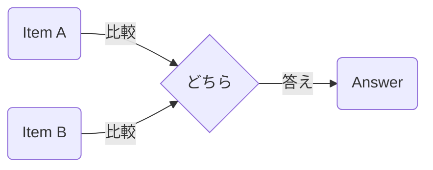

Processing keyword: Aと Bと どちら～ (A to B to dochira~)
# Điểm ngữ pháp tiếng Nhật: Aと Bと どちら～ (A to B to dochira~)

## 1. Giới thiệu
Mẫu ngữ pháp **Aと Bと どちら〜** thường được dùng trong tiếng Nhật để hỏi về sở thích hoặc so sánh hai vật. Nó được dịch là "Cái nào ～ hơn, A hay B?" và rất cần thiết cho các cuộc trò chuyện hàng ngày, đặc biệt khi đưa ra lựa chọn hoặc tìm kiếm ý kiến.

---
## 2. Giải thích ngữ pháp cốt lõi
### Ý nghĩa
**Aと Bと どちら〜** được dùng để so sánh hai vật, người hoặc hành động, và hỏi xem cái nào phù hợp hơn với một miêu tả nhất định. Nó giúp khơi gợi sở thích hoặc so sánh.
### Cấu trúc
Cấu trúc cơ bản của mẫu ngữ pháp này là:
```
A と B と どちら + adjective/verb ですか？
```
- **A** và **B**: Các vật được so sánh.
- **どちら**: "Cái nào" hoặc "cái nào".
- **adjective/verb**: Miêu tả phẩm chất hoặc hành động được so sánh.
### Sơ đồ hình thành
| A       | と  | B       | と  | どちら | ～ですか？ |
|---------|-----|---------|-----|--------|------------|
| Vật A  | và | Vật B  | và | Cái nào  | ～?         |
### Minh họa
Đây là một hình ảnh minh họa:

---
## 3. Phân tích so sánh
Mẫu câu này tương tự như việc dùng **より (yori)** cho so sánh nhưng đặc biệt hỏi về một lựa chọn giữa hai phương án.
- **AはBより～です。**: "A ～ hơn B."
- **AとBとどちらが～ですか。**: "Giữa A và B, cái nào ～ hơn?"
---
## 4. Ví dụ trong ngữ cảnh
### Ví dụ câu
1. **家と車とどちらが高いですか。**
   *Ie to kuruma to dochira ga takai desu ka.*
   "Cái nào đắt hơn, nhà hay xe hơi?"
2. **コーヒーと紅茶とどちらを飲みますか。**
   *Kōhī to kōcha to dochira o nomimasu ka.*
   "Bạn uống cái nào, cà phê hay trà?"
3. **犬と猫とどちらが好きですか。**
   *Inu to neko to dochira ga suki desu ka.*
   "Bạn thích con nào hơn, chó hay mèo?"
4. **日本語と中国語とどちらのほうが難しいですか。**
   *Nihongo to chūgokugo to dochira no hō ga muzukashii desu ka.*
   "Ngôn ngữ nào khó hơn, tiếng Nhật hay tiếng Trung?"
5. **夏と冬とどちらがいいですか。**
   *Natsu to fuyu to dochira ga ii desu ka.*
   "Bạn thích mùa nào, mùa hè hay mùa đông?"
---
## 5. Ghi chú văn hóa
### Tính liên quan văn hóa
Trong văn hóa Nhật Bản, sự gián tiếp và lịch sự được coi trọng. Dùng **Aと Bと どちら〜** cho phép người nói hỏi về sở thích của ai đó một cách lịch sự mà không nghe quá trực tiếp.
### Các cụm từ thành ngữ
- **どちらも好きです。**
  *Dochira mo suki desu.*
  "Tôi thích cả hai."
- **どちらでもいいです。**
  *Dochira demo ii desu.*
  "Cái nào cũng được."
---
## 6. Lỗi thường gặp và mẹo
### Phân tích lỗi
- **Bỏ sót と (to) thứ hai:**
  Sai: **Aと B どちらが～**
  Đúng: **Aと Bと どちらが～**
- **Nhầm lẫn với より (yori):**
  Hãy nhớ rằng **どちら** được dùng để hỏi, trong khi **より** được dùng để khẳng định so sánh.
### Chiến lược học tập
- **Mẹo ghi nhớ:**
  Hãy nghĩ **と** như "và" nối hai phương án, và **どちら** như "cái nào," thúc đẩy một lựa chọn.
- **Luyện tập tạo nên sự hoàn hảo:**
  Tạo câu của riêng bạn so sánh những thứ bạn gặp hàng ngày.
---
## 7. Tóm tắt và ôn tập
### Những điểm chính
- **Aと Bと どちら〜** được dùng để hỏi về sở thích hoặc so sánh giữa hai vật.
- Luôn bao gồm cả hai trợ từ **と** sau A và B.
- Đây là một cách lịch sự để hỏi về ý kiến hoặc lựa chọn của ai đó.
### Bài kiểm tra nhanh
1. Bạn hỏi "Cái nào nhanh hơn, xe hơi hay xe đạp?" bằng tiếng Nhật như thế nào?
2. Điền vào chỗ trống: **リンゴ＿バナナ＿どちらが甘いですか。**
3. Câu trả lời là gì nếu bạn thích cả hai phương án như nhau?
---
**Đáp án:**
1. **車と自転車とどちらが速いですか。**
   *Kuruma to jitensha to dochira ga hayai desu ka.*
2. リンゴ**と**バナナ**と**どちらが甘いですか。
   *Ringo to banana to dochira ga amai desu ka.*
3. **どちらも好きです。**
   *Dochira mo suki desu.*


---

© [Hoangchamchi.org](https://hoangchamchi.org)