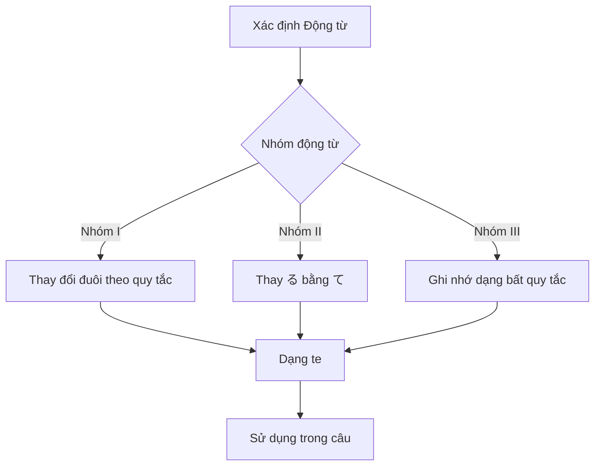

Processing keyword: Verb て～ (Verb + te～)
# Điểm ngữ pháp tiếng Nhật: Verb て～ (Verb + te～)

## 1. Giới thiệu
**Dạng te** của động từ, được gọi là **"te-form"**, là một trong những cách chia động từ thiết yếu và linh hoạt nhất trong ngữ pháp tiếng Nhật. Nắm vững dạng te mở ra cánh cửa để xây dựng các câu phức tạp hơn, diễn tả các hành động đang diễn ra, đưa ra yêu cầu và nối các ý tưởng một cách trôi chảy. Hiểu và sử dụng dạng te là điều quan trọng đối với bất kỳ ai muốn đạt được sự lưu loát trong tiếng Nhật.

---
## 2. Giải thích ngữ pháp cốt lõi
### Ý nghĩa và Cách dùng
Dạng te được dùng để:
- **Nối các hành động tuần tự** (ví dụ: "làm A rồi làm B")
- **Tạo thành thì hiện tại tiếp diễn** (ví dụ: "đang làm")
- **Đưa ra yêu cầu lịch sự** (ví dụ: "xin hãy làm")
- **Cho phép hoặc xin phép** (ví dụ: "tôi có thể làm không")
- **Diễn tả sự cấm đoán** (ví dụ: "không được làm")
- **Cung cấp lý do hoặc nguyên nhân** (ví dụ: "vì tôi đã làm")
### Hình thành Dạng te
Động từ tiếng Nhật được phân thành ba nhóm, và việc hình thành dạng te khác nhau cho mỗi nhóm.
#### Các nhóm động từ
1. **Nhóm I (Động từ godan)**: Động từ kết thúc bằng một phụ âm trước **う** (_động từ -u_)
2. **Nhóm II (Động từ ichidan)**: Động từ kết thúc bằng một nguyên âm trước **る** (_động từ -iru và -eru_)
3. **Nhóm III (Động từ bất quy tắc)**: **する** (_suru_) và **くる** (_kuru_)
---
### Quy tắc hình thành
#### **Nhóm I (Động từ Godan)**
Đối với động từ nhóm I, đuôi thay đổi dựa trên phụ âm trước **う**.
| **Đuôi** | **Đổi sang dạng te** | **Động từ ví dụ** | **Dạng te** |
|------------|--------------------|------------------|-------------|
| **う**, **つ**, **る** | って               | 会う (_au_, gặp)        | 会って       |
| **ぶ**, **む**, **ぬ** | んで               | 飲む (_nomu_, uống)     | 飲んで       |
| **く**          | いて               | 書く (_kaku_, viết)     | 書いて       |
| **ぐ**          | いで               | 泳ぐ (_oyogu_, bơi)     | 泳いで       |
| **す**          | して               | 話す (_hanasu_, nói)   | 話して       |
#### **Nhóm II (Động từ Ichidan)**
Đối với động từ nhóm II, chỉ cần thay **る** bằng **て**.
| **Động từ ví dụ**     | **Dạng te** |
|----------------------|-------------|
| 食べる (_taberu_, ăn) | 食べて       |
| 見る (_miru_, nhìn)     | 見て         |
#### **Nhóm III (Động từ bất quy tắc)**
Hãy ghi nhớ các dạng te của những động từ này.
| **Động từ**          | **Dạng te** |
|-------------------|-------------|
| する (_suru_, làm) | して         |
| くる (_kuru_, đến)| きて         |
---
### Minh họa: Sơ đồ chia động từ

---
## 3. Phân tích so sánh
### Dạng te so với Dạng masu
- **Dạng masu** được dùng để làm cho động từ lịch sự và phù hợp cho các tình huống trang trọng.
  - Ví dụ: 食べます (_tabemasu_, "ăn" một cách lịch sự)
- **Dạng te** không được dùng một mình để hoàn thành câu mà được dùng để nối các động từ, đưa ra yêu cầu hoặc tạo thành các câu ghép.
  - Ví dụ: 食べて (_tabete_, "ăn và...")
**Khác biệt chính**: Dạng masu kết thúc hành động một cách lịch sự, trong khi dạng te nối các hành động hoặc thêm chức năng cho động từ.
---
## 4. Ví dụ trong ngữ cảnh
### 1. Nối các hành động
**彼は朝起きて、ジョギングをします。**
*かれは あさ おきて、ジョギングを します。*
"Anh ấy thức dậy vào buổi sáng và chạy bộ."
### 2. Thì hiện tại tiếp diễn
**彼女は今、音楽を聴いています。**
*かのじょは いま、おんがくを きいています。*
"Cô ấy đang nghe nhạc ngay bây giờ."
### 3. Đưa ra yêu cầu lịch sự
**窓を閉めてください。**
*まどを しめてください。*
"Xin hãy đóng cửa sổ."
### 4. Cho phép
**ここで写真を撮ってもいいですか。**
*ここで しゃしんを とってもいいですか。*
"Tôi có thể chụp ảnh ở đây không?"
### 5. Diễn tả sự cấm đoán
**携帯電話を使ってはいけません。**
*けいたいでんわを つかってはいけません。*
"Bạn không được sử dụng điện thoại di động."
### 6. Diễn tả lý do hoặc nguyên nhân
**雨が降って、試合が延期になりました。**
*あめが ふって、しあいが えんきに なりました。*
"Trời mưa, nên trận đấu đã bị hoãn."
### 7. Hội thoại thân mật
**友達と映画を見て、晩ごはんを食べた。**
*ともだちと えいがを みて、ばんごはんを たべた。*
"Tôi đã xem phim với bạn bè và ăn tối."

---
## 5. Ghi chú văn hóa
### Sự lịch sự và trang trọng
- Dạng te kết hợp với **ください** tạo thành một yêu cầu lịch sự.
  - Ví dụ: 手伝ってください。(_Tetsudatte kudasai._) "Xin hãy giúp tôi."
- Bỏ **ください** làm cho nó thân mật, phù hợp giữa bạn bè thân thiết.
  - Ví dụ: 手伝って。(_Tetsudatte._) "Giúp tôi."
### Thành ngữ dùng dạng te
- **～ている**: Chỉ một hành động đang diễn ra hoặc một trạng thái là kết quả của một hành động.
  - 住んでいる (_sunde iru_): "đang sống"
- **～てしまう**: Truyền đạt sự hoàn thành hoặc sự tiếc nuối.
  - 食べてしまった (_tabete shimatta_): "Tôi đã ăn (hết)" hoặc "Tôi đã vô tình ăn (nó)."
---
## 6. Lỗi thường gặp và mẹo
### Các lỗi thường gặp
1. **Xác định sai nhóm động từ**
   Việc xác định sai nhóm của một động từ có thể dẫn đến chia sai.
   - Lỗi: **起きる (okiru)** -> **起きって** ❌
   - Sửa: **起きる** là động từ nhóm II, vì vậy nó trở thành **起きて** ✅
2. **Bỏ qua các động từ bất quy tắc**
   Quên rằng **する** và **くる** là bất quy tắc.
   - Lỗi: **する** -> **すて** ❌
   - Sửa: **する** -> **して** ✅
### Mẹo học tập
- **Mẹo ghi nhớ cho động từ Nhóm I kết thúc bằng う, つ, る**
  - Hãy nhớ "**Utsuru -> Tte**"
  - Các động từ kết thúc bằng **う**, **つ**, **る** đổi thành **って**
- **Cho các động từ kết thúc bằng む, ぶ, ぬ**
  - Hãy nhớ "**MuBuNu -> Nde**"
  - Chúng đổi thành **んで**
- **Luyện tập phân nhóm động từ**
  - Thường xuyên luyện tập phân loại động từ vào đúng nhóm của chúng.
---
## 7. Tóm tắt và ôn tập
### Những điểm chính
- **Dạng te** rất quan trọng để nối các động từ và tạo thành nhiều cấu trúc ngữ pháp khác nhau.
- Việc hình thành đúng phụ thuộc vào việc xác định chính xác nhóm động từ.
- Dạng te được dùng trong nhiều biểu thức và rất cần thiết cho giao tiếp hằng ngày.
### Bài kiểm tra nhanh
1. **Chuyển động từ 読む (_yomu_, "đọc") sang dạng te.**
   **Đáp án:** 読んで (_yonde_)
2. **Bạn nói "Xin hãy nói chậm" bằng dạng te như thế nào?**
   **Đáp án:** ゆっくり話してください。(_Yukkuri hanashite kudasai._)
3. **Dạng te của 行く (_iku_, "đi") là gì?**
   **Đáp án:** 行って (_itte_)
---
*Hãy tiếp tục luyện tập dạng te trong các ngữ cảnh khác nhau để nâng cao hiểu biết và sự lưu loát của bạn!*

---

© [Hoangchamchi.org](https://hoangchamchi.org)