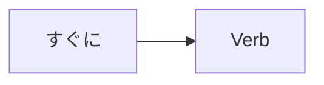

Processing keyword: すぐに～ (sugu ni～)
# Điểm ngữ pháp tiếng Nhật: すぐに～ (sugu ni～)

## 1. Giới thiệu
Trạng từ tiếng Nhật **すぐに (sugu ni)** thường được dùng để diễn đạt ý "ngay lập tức," "ngay bây giờ," hoặc "chẳng bao lâu nữa." Đây là một thuật ngữ thiết yếu để chỉ sự nhanh chóng hoặc tức thời trong các hành động và sự kiện. Hiểu cách dùng **すぐに** một cách chính xác sẽ nâng cao khả năng mô tả các sắc thái liên quan đến thời gian trong hội thoại tiếng Nhật.

---
## 2. Giải thích ngữ pháp cốt lõi
### Ý nghĩa
- **すぐに**: ngay lập tức; ngay bây giờ; chẳng bao lâu nữa
### Cấu trúc
Trạng từ **すぐに** được đặt trước một động từ để chỉ ra rằng hành động sẽ xảy ra không chậm trễ.
```
すぐに + Verb
```
### Sơ đồ hình thành

---
## 3. Phân tích so sánh
**すぐに** so với **もうすぐ**
- **すぐに**: Chỉ một hành động sẽ xảy ra ngay lập tức.
  - Ví dụ: すぐに始めます。(Tôi sẽ bắt đầu ngay lập tức.)
- **もうすぐ**: Có nghĩa là "chẳng bao lâu nữa" hoặc "một lát nữa," hàm ý một khoảng thời gian ngắn trước khi việc gì đó xảy ra.
  - Ví dụ: もうすぐ夏休みです。(Kỳ nghỉ hè sắp đến rồi.)
---
## 4. Ví dụ trong ngữ cảnh
### Tình huống trang trọng
1. **会議をすぐに始めます。**
   - *Kaigi o sugu ni hajimemasu.*
   - "Chúng tôi sẽ bắt đầu cuộc họp ngay lập tức."
2. **申し込みはすぐに締め切られます。**
   - *Mōshikomi wa sugu ni shimekira remasu.*
   - "Đơn đăng ký sẽ đóng ngay lập tức."
### Tình huống thân mật
1. **すぐに戻ってくるよ。**
   - *Sugu ni modotte kuru yo.*
   - "Tôi sẽ quay lại ngay."
2. **すぐに行かなきゃ。**
   - *Sugu ni ikanakya.*
   - "Tôi phải đi ngay."
### Ngữ cảnh viết
1. **注文後、商品はすぐに発送されます。**
   - *Chūmon go, shōhin wa sugu ni hassō saremasu.*
   - "Sau khi đặt hàng, sản phẩm sẽ được gửi ngay lập tức."
### Ngữ cảnh nói
1. **店員：ご注文はお決まりですか。**
   - *Ten'in: Go-chūmon wa okimari desu ka.*
   - "Nhân viên: Quý khách đã quyết định món chưa ạ?"
2. **客：はい、すぐにお願いします。**
   - *Kyaku: Hai, sugu ni onegaishimasu.*
   - "Khách hàng: Vâng, làm ơn ngay nhé."
---
## 5. Ghi chú văn hóa
### Ý nghĩa văn hóa
Trong văn hóa Nhật Bản, sự đúng giờ và nhanh nhẹn được đánh giá rất cao. Dùng **すぐに** phản ánh sự tôn trọng thời gian của người khác và truyền đạt cảm giác khẩn trương hoặc chu đáo. Điều này có thể đặc biệt quan trọng trong môi trường kinh doanh hoặc khi thể hiện sự lịch thiệp.

---
## 6. Lỗi thường gặp và mẹo
### Phân tích lỗi
- **Lỗi**: Đặt **すぐに** sau động từ.
  - Sai: **帰りますすぐに。**
    - *Kairimasu sugu ni.*
  - Đúng: **すぐに帰ります。**
    - *Sugu ni kaerimasu.*
- **Lỗi**: Nhầm lẫn **すぐに** với **すこし (sukoshi)** vốn có nghĩa là "một chút."
  - Cẩn thận đừng trộn lẫn chúng vì âm thanh tương tự.
### Chiến lược học tập
- **Mẹo ghi nhớ**: Hãy nghĩ **すぐに** là "soon ni," nhắc bạn rằng nó có nghĩa là "chẳng bao lâu nữa" hoặc "ngay lập tức."
- **Mẹo luyện tập**: Dùng **すぐに** trong các lời nhắc hằng ngày. Ví dụ: "すぐに勉強する！" (*Học ngay lập tức!*)
---
## 7. Tóm tắt và ôn tập
### Những điểm chính
- **すぐに** có nghĩa là "ngay lập tức" hoặc "ngay bây giờ."
- Nó được đặt **trước động từ** để chỉ hành động nhanh chóng.
- Đừng nhầm lẫn **すぐに** với **もうすぐ** hoặc **すこし**.
- Việc dùng đúng **すぐに** phản ánh sự chu đáo và tôn trọng thời gian trong văn hóa Nhật Bản.
### Bài kiểm tra nhanh
1. Bạn nói "Tôi sẽ gọi điện cho bạn ngay lập tức" trong tiếng Nhật như thế nào?
   - **Đáp án**: すぐに電話します。(*Sugu ni denwa shimasu.*)
2. Câu nào đúng?
   - a) 帰りますすぐに。
   - b) すぐに帰ります。
   - **Đáp án**: b) すぐに帰ります。
3. **もうすぐ** có nghĩa là gì?
   - **Đáp án**: "Chẳng bao lâu nữa" hoặc "một lát nữa," nhưng không phải ngay lập tức.
---
Bằng cách nắm vững **すぐに**, bạn nâng cao khả năng diễn đạt sự khẩn trương và tức thời trong tiếng Nhật, giúp giao tiếp của bạn chính xác và phù hợp văn hóa hơn.


---

© [Hoangchamchi.org](https://hoangchamchi.org)