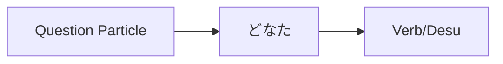

Processing keyword: どなた～ (donata～)
# Điểm ngữ pháp tiếng Nhật: どなた～ (donata～)

## 1. Giới thiệu
Trong bài học này, chúng ta sẽ khám phá cách dùng của **どなた** (donata), một đại từ nghi vấn lịch sự trong tiếng Nhật. Hiểu cách dùng **どなた** một cách phù hợp là điều thiết yếu cho giao tiếp mang tính tôn trọng, đặc biệt trong các bối cảnh trang trọng.

---
## 2. Giải thích ngữ pháp cốt lõi
### Ý nghĩa
**どなた** (donata) có nghĩa là **"ai"**. Đây là dạng lịch sự hoặc kính ngữ của **誰** (dare), cũng mang nghĩa "ai".
### Cấu trúc
Từ **どなた** được dùng trong câu hỏi để hỏi về danh tính của một người một cách lịch sự.
#### Sơ đồ hình thành

- **どなたですか？**  
  "Bạn là ai?" (Lịch sự)
### Ghi chú cách dùng
- **どなた** thường được dùng trong các tình huống trang trọng, chẳng hạn như họp kinh doanh, dịch vụ khách hàng, hoặc khi nói chuyện với người có địa vị xã hội cao hơn.
- Nó được coi là tôn trọng hơn **誰** (dare).
---
## 3. Phân tích so sánh
| Tiếng Nhật      | Phiên âm | Mức độ lịch sự | Cách dùng                         |
| ------------- | ------- | ---------------- | ----------------------------- |
| 誰            | dare    | Suồng sã           | Dùng giữa bạn bè, người ngang vai     |
| どなた        | donata  | Lịch sự/Trang trọng    | Dùng trong các bối cảnh trang trọng       |
| どちら様      | dochira-sama | Rất lịch sự/Kính ngữ | Cực kỳ lịch sự, dùng trong các ngữ cảnh rất trang trọng |
---
## 4. Ví dụ trong ngữ cảnh
### Câu ví dụ
1. **こちらはどなたですか。**  
   *Kochira wa donata desu ka.*  
   "Người này là ai?" (Câu hỏi lịch sự)
2. **お電話をくださったのはどなたでしょうか。**  
   *O-denwa o kudasatta no wa donata deshou ka.*  
   "Người đã gọi điện có thể là ai nhỉ?" (Lịch sự, kính ngữ)
3. **会場にはどなたがいらっしゃいますか。**  
   *Kaijou ni wa donata ga irasshaimasu ka.*  
   "Ai có mặt tại hội trường?" (Lịch sự, dùng động từ kính ngữ)
4. **どなたにお会いしたいですか。**  
   *Donata ni o-ai shitai desu ka.*  
   "Bạn muốn gặp ai?" (Lịch sự)
### Cách dùng theo ngữ cảnh
- **Bối cảnh trang trọng (Công việc):**  
  **どなたがプロジェクトの責任者ですか。**  
  *Donata ga purojekuto no sekininsha desu ka.*  
  "Ai là người phụ trách dự án?"
- **Dịch vụ khách hàng:**  
  **ご予約はどなたの名前でされていますか。**  
  *Goyoyaku wa donata no namae de sarete imasu ka.*  
  "Việc đặt chỗ được thực hiện dưới tên ai?"
---
## 5. Ghi chú văn hóa
### Ý nghĩa văn hóa
Việc dùng **どなた** phản ánh sự nhấn mạnh của văn hóa Nhật Bản vào sự tôn trọng và thứ bậc xã hội. Điều quan trọng là phải dùng mức độ lịch sự phù hợp để thể hiện sự tôn trọng, đặc biệt trong các tình huống sau:
- Nói chuyện với khách hàng hoặc đối tác
- Xưng hô với người lớn tuổi hoặc cấp trên
- Các dịp trang trọng và lời giới thiệu
### Thành ngữ
- **どなた様でしょうか。**  
  *Donata-sama deshou ka.*  
  Một cách cực kỳ lịch sự để hỏi "Ai đây ạ?", thường được dùng khi nghe điện thoại hoặc ra mở cửa.
---
## 6. Lỗi thường gặp và mẹo
### Phân tích lỗi
- **Dùng 誰 (dare) thay vì どなた (donata) trong các tình huống trang trọng:**  
  Điều này có thể bị coi là thô lỗ hoặc quá suồng sã.
  - Sai: **あなたは誰ですか。** (*Anata wa dare desu ka.*)
  - Đúng: **どなたですか。** (*Donata desu ka.*)
### Chiến lược học tập
- **Thủ thuật ghi nhớ:**  
  Hãy nghĩ **どなた** như "Don (Ngài) + ata (người)" để nhớ rằng đây là dạng lịch sự khi hỏi về ai đó.
- **Luyện tập các mức độ lịch sự:**  
  Kết hợp **どなた** với động từ kính ngữ để tăng thêm độ lịch sự. Ví dụ, dùng **いらっしゃいます** thay vì **います**.
---
## 7. Tóm tắt và ôn tập
### Bài học chính
- **どなた** là dạng lịch sự của **誰** (ai).
- Dùng **どなた** trong các tình huống trang trọng để thể hiện sự tôn trọng.
- Hãy nhớ điều chỉnh mức độ lịch sự dựa trên ngữ cảnh và người bạn đang nói chuyện.
### Bài kiểm tra nhanh
1. Bạn hỏi "Người này là ai?" một cách lịch sự bằng tiếng Nhật như thế nào?
   a) **これは誰ですか。**  
   b) **こちらはどなたですか。**  
   c) **これは何ですか。**
2. Cái nào lịch sự hơn: **誰** hay **どなた**?
3. Điền từ thích hợp vào chỗ trống: **ご担当者は ______ でしょうか。**  
   (*Ai là người phụ trách?*)
---
**Đáp án:**
1. b) **こちらはどなたですか。**
2. **どなた** lịch sự hơn **誰**.
3. **どなた** — **ご担当者はどなたでしょうか。**

---

© [Hoangchamchi.org](https://hoangchamchi.org)