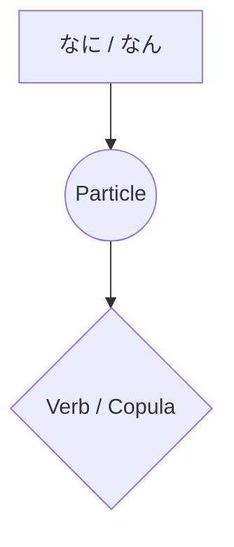

Processing keyword: なに～ (nani~)
# Điểm ngữ pháp tiếng Nhật: なに～ (nani～)

## 1. Giới thiệu
Từ **なに** (nani) là một đại từ nghi vấn cơ bản trong tiếng Nhật, có nghĩa là **"cái gì"**. Nó được dùng để hỏi về sự vật, hành động và mô tả. Hiểu cách dùng **なに** đúng là điều thiết yếu để giao tiếp hiệu quả trong tiếng Nhật.

---
## 2. Giải thích ngữ pháp cốt lõi
### Ý nghĩa và cách dùng
- **なに (nani)**: Có nghĩa là **"cái gì"** và được dùng để hỏi về sự vật, hành động hoặc lời giải thích.
- Nó có thể kết hợp với trợ từ để tạo thành câu hỏi hoặc cách diễn đạt.
### Cấu trúc và cách tạo thành
#### Cấu trúc câu hỏi cơ bản
```markdown
[Question Word] + [Particle] + [Verb] + か？
```
- **なにをしますか？**
  - _Nani o shimasu ka?_
  - "(Bạn) sẽ làm gì?"
#### Kết hợp với trợ từ
| Trợ từ | Cách dùng                        | Ví dụ                         | Bản dịch                 |
|----------|------------------------------|---------------------------------|-----------------------------|
| **が**   | Đánh dấu chủ ngữ            | なにが必要ですか？              | Cái gì là cần thiết?          |
| **を**   | Đánh dấu tân ngữ trực tiếp      | なにを食べますか？              | (Bạn) sẽ ăn gì?        |
| **に**   | Chỉ hướng hoặc thời gian  | なににしますか？                | Bạn sẽ chọn gì?  |
| **で**   | Chỉ phương tiện hoặc địa điểm  | なにで行きますか？              | Bạn sẽ đi bằng phương tiện gì?  |
| **も**   | Mang nghĩa "bất cứ thứ gì/không gì cả"     | なにもいりません。              | Tôi không cần gì cả.      |
| **か**   | Mang nghĩa "một thứ gì đó/bất cứ thứ gì"   | なにかありますか？              | Có thứ gì đó không?         |
### Khác biệt giữa なに và なん
Cả **なに** và **なん** đều có nghĩa là "gì," nhưng cách dùng của chúng phụ thuộc vào ngữ cảnh và từ đứng sau:
- **なに** được dùng trước trợ từ và ở dạng đứng một mình.
  - **なにをしますか？** (_Bạn sẽ làm gì?_)
- **なん** được dùng trước các từ bắt đầu bằng **d**, **t**, **n** và các từ đếm.
  - **なんですか？** (_Đó là gì?_)
  - **なんにんいますか？** (_Có bao nhiêu người?_)
  
### Sơ đồ hình thành

---
## 3. Phân tích so sánh
### なに vs. なん
- Dùng **なに**:
  - Trước trợ từ (**が, を, に, で, も**)
    - **なにを食べますか？** (_Bạn sẽ ăn gì?_)
- Dùng **なん**:
  - Trước **です**
    - **なんですか？** (_Đó là gì?_)
  - Trước các từ bắt đầu bằng **d**, **t**, **n**
    - **なんで行きますか？** (_Bạn sẽ đi bằng gì?_)
  - Trước các từ đếm
    - **なんにんいますか？** (_Có bao nhiêu người?_)
### So sánh với các từ nghi vấn khác
| Tiếng Nhật | Phiên âm   | Ý nghĩa    |
|----------|-----------|------------|
| どれ     | dore      | Cái nào  |
| どの     | dono      | Nào ~    |
| だれ     | dare      | Ai        |
| いつ     | itsu      | Khi nào       |
| どこ     | doko      | Ở đâu      |
| **なに** | **nani**  | **Cái gì**   |
---
## 4. Ví dụ trong ngữ cảnh
### Lời nói trang trọng
1. **お名前はなんですか？**
   - _O-namae wa nan desu ka?_
   - "Tên của bạn là gì?"
2. **これはなにがありますか？**
   - _Kore wa nani ga arimasu ka?_
   - "Ở đây có gì?"
### Lời nói thân mật
1. **なに食べる？**
   - _Nani taberu?_
   - "Cậu định ăn gì?"
2. **週末になにするの？**
   - _Shūmatsu ni nani suru no?_
   - "Cuối tuần cậu làm gì?"
### Ngữ cảnh viết
1. **この言葉の意味はなんですか。**
   - _Kono kotoba no imi wa nan desu ka._
   - "Nghĩa của từ này là gì?"
2. **なにを求めていますか。**
   - _Nani o motomete imasu ka._
   - "Bạn đang tìm kiếm điều gì?"
### Ngữ cảnh nói
1. **えっ、なんだって？**
   - _Eh, nan datte?_
   - "Ơ, cậu nói gì cơ?"
2. **なにが起こったの？**
   - _Nani ga okotta no?_
   - "Đã xảy ra chuyện gì?"
---
## 5. Ghi chú văn hóa
### Mức độ lịch sự
- Dùng **なんですか** khá suồng sã và đôi khi có thể nghe cộc lốc.
  - Để lịch sự hơn, hãy dùng **なんでしょうか** hoặc thêm tiền tố **お**: **おなまえは？**
### Thành ngữ
1. **なになに**
   - Được dùng để thể hiện sự quan tâm hoặc thúc giục ai đó tiếp tục.
     - **なになに、もっと教えて。**
       - _Nani nani, motto oshiete._
       - "Gì cơ, gì cơ? Kể thêm đi."
2. **なになにかんになになに**
   - Một chỗ trống cho các vật không xác định, tương tự như "gì gì đó."
     - **彼はなになに会社の社長だ。**
       - _Kare wa naninani kaisha no shachō da._
       - "Anh ấy là chủ tịch của công ty gì gì đó."
---
## 6. Lỗi thường gặp và mẹo
### Lỗi thường gặp
- **Dùng "nani" và "nan" thay thế cho nhau mà không xét đến từ đứng sau.**
  - Sai: **なにですか？**
  - Đúng: **なんですか？**
- **Quên trợ từ sau "nani."**
  - Sai: **なに食べますか？**
  - Đúng: **なにを食べますか？**
### Mẹo
- **Ghi nhớ "Quy tắc D/T/N":** Dùng **なん** trước các từ bắt đầu bằng **d**, **t**, **n** hoặc các từ đếm.
- **Dùng trợ từ cho đúng:** Luôn thêm trợ từ phù hợp sau **なに** để làm rõ vai trò ngữ pháp.
---
## 7. Tóm tắt và ôn tập
### Bài học chính
- **なに** có nghĩa là "cái gì" và rất quan trọng để đặt câu hỏi.
- Dùng **なに** hoặc **なん** tùy thuộc vào từ đứng sau.
- Kết hợp **なに** với trợ từ để tạo thành các câu hỏi cụ thể.
- Hãy chú ý đến mức độ lịch sự khi dùng **なに** trong hội thoại.
### Bài kiểm tra nhanh
1. Điền vào chỗ trống: **______で行きますか？** (_Bạn sẽ đi bằng phương tiện gì?_)
   - **Đáp án:** なんで
2. Câu này có đúng không? **なにですか？**
   - **Đáp án:** Không, phải là **なんですか？**
3. Bạn nói "Bạn sẽ uống gì?" bằng tiếng Nhật như thế nào?
   - **Đáp án:** **なにを飲みますか？**
---
Bằng cách nắm vững **なに**, bạn sẽ có thể đặt nhiều loại câu hỏi khác nhau và nâng cao giao tiếp tiếng Nhật của mình. Hãy nhớ chú ý đến ngữ cảnh và các quy tắc dùng **なに** và **なん**.


---

© [Hoangchamchi.org](https://hoangchamchi.org)