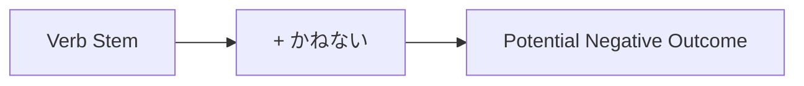

Processing keyword: ～かねない (〜kane nai)
# Điểm ngữ pháp tiếng Nhật: ～かねない (〜kane nai)

## 1. Giới thiệu
Trong bài học này, chúng ta sẽ khám phá điểm ngữ pháp tiếng Nhật **～かねない (〜kane nai)**. Cách diễn đạt này được dùng để chỉ ra rằng có khả năng một điều gì đó tiêu cực hoặc không mong muốn sẽ xảy ra. Hiểu cách dùng **～かねない** sẽ giúp bạn diễn đạt các kết quả tiêu cực tiềm ẩn hoặc mối lo ngại trong nhiều ngữ cảnh khác nhau.

---
## 2. Giải thích ngữ pháp cốt lõi
### Ý nghĩa
**～かねない** có nghĩa là "**có thể (dẫn đến)**", "**có thể xảy ra**", hoặc "**có khả năng là**" một điều gì đó tiêu cực có thể xảy ra. Nó được dùng để cảnh báo hoặc bày tỏ lo ngại về một kết quả không mong muốn tiềm ẩn.
### Cấu trúc
Cấu trúc sử dụng **～かねない** là:
```
Verb Stem + かねない
```
### Sơ đồ hình thành
| Dạng động từ     | + かねない | Dạng kết quả        |
|---------------|-----------|-----------------------|
| 読み (từ 読む) | かねない    | 読みかねない           |
| 起こし (từ 起こす) | かねない    | 起こしかねない         |
| なり (từ なる) | かねない    | なりかねない           |
### Giải thích chi tiết
- **Thân động từ**: Thân động từ có được bằng cách bỏ **-ます** khỏi dạng **-ます** của động từ.
  - Ví dụ: **食べます** → **食べ** (thân)
- **～かねない** gắn trực tiếp vào thân động từ.
- Cách diễn đạt này được dùng để chỉ một kết quả tiêu cực tiềm ẩn được coi là có thể xảy ra trong hoàn cảnh đó.
### Minh họa trực quan: Sơ đồ luồng cách dùng

---
## 3. Phân tích so sánh
### ～かねる vs. ～かねない
- **～かねる**: Có nghĩa là "**không thể làm**" hoặc "**khó làm**", diễn đạt sự không thể hoặc miễn cưỡng.
  - Ví dụ: ご期待には応じかねます。 (Tôi không thể đáp ứng yêu cầu của bạn.)
- **～かねない**: Có nghĩa là "**có thể xảy ra**", đặc biệt là một sự kiện tiêu cực.
  - Ví dụ: 彼は秘密を漏らしかねない。 (Anh ấy có thể làm lộ bí mật.)
**Sự khác biệt**: Trong khi **～かねる** diễn đạt sự không thể hoặc từ chối, **～かねない** diễn đạt khả năng một điều gì đó (thường là tiêu cực) xảy ra.
---
## 4. Ví dụ trong ngữ cảnh
### Câu ví dụ
1. **彼の言い方は誤解を招きかねない。**
   - *Kare no iikata wa gokai o maneki kane nai.*
   - *Cách nói chuyện của anh ấy có thể gây hiểu lầm.*
2. **そんな無責任な態度では、問題が起こりかねない。**
   - *Sonna musekinin na taido de wa, mondai ga okori kane nai.*
   - *Với thái độ vô trách nhiệm như vậy, vấn đề có thể phát sinh.*
3. **このまま雨が降り続けば、川が氾濫しかねない。**
   - *Kono mama ame ga furitsudzukeba, kawa ga hanran shi kane nai.*
   - *Nếu trời cứ mưa mãi như thế này, sông có thể bị ngập lụt.*
4. **あまりお酒を飲むと健康を害しかねない。**
   - *Amari osake o nomu to kenkō o gaishi kane nai.*
   - *Uống quá nhiều rượu có thể gây hại cho sức khỏe.*
5. **彼女は怒りを抑えきれず、言い過ぎてしまいかねない。**
   - *Kanojo wa ikari o osae kirezu, iisugite shimai kane nai.*
   - *Không kìm chế được cơn giận, cô ấy có thể sẽ nói quá lời.*
---
## 5. Ghi chú văn hóa
### Mức độ lịch sự và trang trọng
- **～かねない** là một cách diễn đạt trung tính và có thể được dùng trong cả ngữ cảnh trang trọng lẫn thân mật.
- Thường được dùng trong ngôn ngữ viết, bản tin hoặc các phát biểu trang trọng để cảnh báo về các rủi ro tiềm ẩn.
### Thành ngữ
- **死にかねない**: Có thể chết.
  - Được dùng để nhấn mạnh mức độ nghiêm trọng của một tình huống.
- **忘れかねない**: Có thể quên.
  - Được dùng để bày tỏ lo ngại về việc quên một điều gì đó quan trọng.
---
## 6. Lỗi thường gặp và mẹo
### Phân tích lỗi
- **Lỗi**: Dùng dạng từ điển thường của động từ thay vì thân động từ.
  - Sai: *食べるかねない*
  - Đúng: *食べかねない*
- **Lỗi**: Nhầm lẫn **～かねない** với **～かもしれない** (có lẽ, có thể).
  - Trong khi cả hai đều diễn đạt khả năng, **～かねない** thường hàm ý một kết quả tiêu cực và chắc chắn hơn.
### Chiến lược học tập
- **Thủ thuật ghi nhớ**: Hãy nghĩ **～かねない** như "không thể tránh khỏi (hậu quả tiêu cực)".
- **Liên tưởng**: Liên hệ **かねない** với "金" (tiền) và nghĩ "Nếu tôi tiêu quá nhiều, tôi có thể hết tiền (kết quả tiêu cực)."
---
## 7. Tóm tắt và ôn tập
### Bài học chính
- **～かねない** được dùng để diễn đạt một kết quả tiêu cực tiềm ẩn.
- Được tạo thành bằng cách gắn **かねない** vào thân động từ.
- Hàm ý rằng trong những điều kiện nhất định, một điều gì đó không mong muốn có thể xảy ra.
- Khác với **～かもしれない** vì nó thường truyền đạt cảm giác tiêu cực mạnh hơn.
### Bài kiểm tra nhanh
1. Bạn tạo **～かねない** với động từ **書く** như thế nào?
   - **Đáp án**: 書きかねない
2. Sắc thái chính của **～かねない** là gì?
   - **Đáp án**: Nó diễn đạt rằng có khả năng một kết quả tiêu cực hoặc không mong muốn sẽ xảy ra.
3. Dịch câu: そんなことを言うと、彼を怒らせかねない。
   - **Đáp án**: Nếu bạn nói điều gì đó như vậy, bạn có thể làm anh ấy tức giận.
---
Bằng cách nắm vững **～かねない**, bạn có thể diễn đạt hiệu quả các lo ngại về hậu quả tiêu cực tiềm ẩn trong tiếng Nhật, nâng cao cả kỹ năng giao tiếp nói và viết của bạn.


---

© [Hoangchamchi.org](https://hoangchamchi.org)