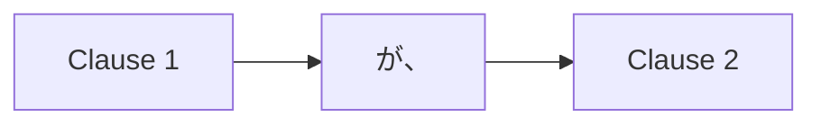

Processing keyword: ～が、～ (〜ga, 〜)
# Điểm ngữ pháp tiếng Nhật: ～が、～ (〜ga, 〜)

## 1. Giới thiệu
Trong bài học này, chúng ta sẽ khám phá điểm ngữ pháp tiếng Nhật **～が、～ (〜ga, 〜)**. Cấu trúc này được dùng để nối hai mệnh đề, thường để diễn đạt sự tương phản hoặc trình bày thông tin bổ sung, đôi khi bất ngờ. Nắm vững cấu trúc ngữ pháp này sẽ giúp bạn tạo ra các câu phức tạp hơn và diễn đạt những suy nghĩ tinh tế trong tiếng Nhật.
## 2. Giải thích ngữ pháp cốt lõi
### Ý nghĩa
Trợ từ **が** hoạt động như một liên từ mang nghĩa **"nhưng"**, **"tuy nhiên"** hoặc **"mặc dù"** khi được dùng để nối hai mệnh đề. Nó chỉ ra rằng mệnh đề thứ hai tương phản với hoặc bổ sung thông tin cho mệnh đề đầu.
### Cấu trúc
**[Mệnh đề 1]** + **が、** + **[Mệnh đề 2]**
- **Mệnh đề 1**: Bất kỳ câu trần thuật nào.
- **が、**: Trợ từ liên từ mang nghĩa "nhưng" hoặc "tuy nhiên".
- **Mệnh đề 2**: Một câu tương phản với hoặc bổ sung cho Mệnh đề 1.
#### Sơ đồ hình thành

### Minh họa trực quan: Bảng cấu trúc
| Thành phần   | Vai trò                    | Ví dụ                 |
|-------------|-------------------------|-------------------------|
| Mệnh đề 1    | Phát biểu ban đầu       | この本は面白い          |
| が、        | Liên từ (nhưng/tuy nhiên)| が、                    |
| Mệnh đề 2    | Phát biểu tương phản/bổ sung | 高いです |
**Câu kết hợp:** この本は面白い**が、**高いです。
**Bản dịch:** Cuốn sách này thú vị, **nhưng** nó đắt.
## 3. Phân tích so sánh
Hãy so sánh **が** với các liên từ khác mang nghĩa "nhưng":
- **でも**: Được dùng ở đầu câu thứ hai; suồng sã hơn.
  - **Ví dụ:** この本は面白いです。**でも、**高いです。
- **しかし**: Trang trọng, thường được dùng trong ngôn ngữ viết.
  - **Ví dụ:** この本は面白いです。**しかし、**高いです。
- **けど/けれども**: Tương tự **が**, với khác biệt nhỏ về độ trang trọng.
  - **Ví dụ:** この本は面白い**けど**、高いです。
**が** được chèn giữa các mệnh đề trong một câu duy nhất, làm cho sự chuyển tiếp mượt mà hơn và trang trọng hơn một chút so với **でも** hoặc **けど**.
## 4. Ví dụ trong ngữ cảnh
### Ví dụ 1: Ngữ cảnh viết trang trọng
**Câu:** 日本語は難しい**が、**とても面白いです。
**Romaji:** Nihongo wa muzukashii **ga,** totemo omoshiroi desu.
**Bản dịch:** Tiếng Nhật khó, **nhưng** nó rất thú vị.
### Ví dụ 2: Hội thoại lịch sự
**Câu:** すみません**が、**塩を取ってください。
**Romaji:** Sumimasen **ga,** shio o totte kudasai.
**Bản dịch:** Xin lỗi, **nhưng** làm ơn đưa giúp tôi lọ muối.
### Ví dụ 3: Diễn đạt sự tương phản
**Câu:** 映画を見たい**が、**時間がありません。
**Romaji:** Eiga o mitai **ga,** jikan ga arimasen.
**Bản dịch:** Tôi muốn xem phim, **nhưng** tôi không có thời gian.
### Ví dụ 4: Thêm thông tin bất ngờ
**Câu:** 彼は若い**が、**経験があります。
**Romaji:** Kare wa wakai **ga,** keiken ga arimasu.
**Bản dịch:** Anh ấy trẻ, **nhưng** anh ấy có kinh nghiệm.
### Ví dụ 5: Ngữ cảnh nói suồng sã
**Câu:** 天気はいい**が、**寒いです。
**Romaji:** Tenki wa ii **ga,** samui desu.
**Bản dịch:** Thời tiết đẹp, **nhưng** trời lạnh.
## 5. Ghi chú văn hóa
### Ý nghĩa văn hóa
Trong giao tiếp Nhật Bản, sự gián tiếp và lịch sự được đánh giá rất cao. Dùng **が** cho phép người nói trình bày thông tin tương phản mà không nghe đột ngột hoặc bất lịch sự. Nó làm mềm phát biểu và tôn trọng cảm xúc của người nghe.
### Mức độ lịch sự và trang trọng
- **が、** được coi là lịch sự và phù hợp cho cả các tình huống trang trọng và bán trang trọng.
- Nó ít suồng sã hơn **けど**, khiến nó phù hợp trong các môi trường chuyên nghiệp hoặc khi nói chuyện với cấp trên.
### Thành ngữ
- **申し訳ありませんが、** (Mōshiwake arimasen ga,): "Tôi xin lỗi, nhưng..."
- **残念ですが、** (Zannen desu ga,): "Thật đáng tiếc, nhưng..."
Những cách diễn đạt này thường được dùng để lịch sự giới thiệu tin xấu hoặc từ chối một lời đề nghị.
## 6. Lỗi thường gặp và mẹo
### Phân tích lỗi
**Lỗi 1:** Nhầm lẫn **が** (trợ từ đánh dấu chủ ngữ) với **が、** (liên từ)
- **Ví dụ trợ từ đánh dấu chủ ngữ:** 私**が**行きます。 (Tôi sẽ đi.)
- **Ví dụ liên từ:** 行きたい**が、**忙しいです。 (Tôi muốn đi, **nhưng** tôi bận.)
**Mẹo:** Khi **が** được theo sau bởi dấu phẩy hoặc được dùng giữa hai mệnh đề, nó hoạt động như một liên từ.
**Lỗi 2:** Lạm dụng **が、** trong lời nói suồng sã
- Trong các cuộc trò chuyện suồng sã, **けど** hoặc **けれど** có thể phù hợp hơn.
- **Ví dụ:** 映画を見たい**けど、**お金がない。
### Chiến lược học tập
- **Luyện tập nối mệnh đề:** Hãy viết câu dùng **が、** để nối các ý tưởng tương phản.
- **Đóng vai:** Hãy tham gia các cuộc hội thoại trong đó bạn cần lịch sự từ chối hoặc trình bày thông tin tương phản.
- **Bài tập nghe:** Hãy nghe các bài phát biểu trang trọng hoặc bản tin để nghe cách **が、** được dùng một cách tự nhiên.
## 7. Tóm tắt và ôn tập
### Bài học chính
- **が、** được dùng như một liên từ mang nghĩa "nhưng" hoặc "tuy nhiên".
- Nó nối hai mệnh đề, với mệnh đề thứ hai tương phản với hoặc bổ sung cho mệnh đề đầu.
- Nó lịch sự và phù hợp cho các tình huống trang trọng.
- Hãy chú ý đến ngữ cảnh để chọn liên từ phù hợp (**が、**, **でも**, **けど**).
### Bài kiểm tra nhanh
1. **が、** có nghĩa là gì khi nối hai mệnh đề?
2. **が、** trang trọng hơn hay suồng sã hơn so với **けど**?
3. Viết lại các câu sau thành một câu dùng **が、**:
   - **Câu 1:** 明日は休みです。
   - **Câu 2:** 私は仕事をします。
### Đáp án
1. Nó có nghĩa là "nhưng" hoặc "tuy nhiên", nối hai mệnh đề tương phản.
2. Trang trọng hơn.
3. 明日は休みです**が、**私は仕事をします。

---
Bằng cách hiểu và luyện tập cách dùng **～が、～ (〜ga, 〜)**, bạn sẽ nâng cao khả năng diễn đạt những suy nghĩ phức tạp một cách lịch sự và hiệu quả trong tiếng Nhật.

---

© [Hoangchamchi.org](https://hoangchamchi.org)