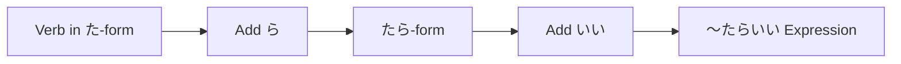

Processing keyword: ～たらいい (〜tara ii)
# Điểm ngữ pháp tiếng Nhật: ～たらいい (〜tara ii)

## 1. Giới thiệu
Diễn đạt **～たらいい (〜tara ii)** là một điểm ngữ pháp tiếng Nhật linh hoạt được dùng để đưa ra lời khuyên, đề nghị, hoặc diễn đạt hy vọng và ước muốn. Nó được dịch thành các cụm từ như "Sẽ tốt nếu..." hoặc "Bạn nên...". Cấu trúc này cho phép người nói đưa ra khuyến nghị một cách lịch sự và gián tiếp, phù hợp với chuẩn mực văn hóa Nhật Bản về sự tinh tế trong giao tiếp.

---
## 2. Giải thích ngữ pháp cốt lõi
### Ý nghĩa và cách dùng
- **Đưa ra lời khuyên hoặc đề nghị**: Đề xuất một hành động mà ai đó nên thực hiện.
- **Diễn đạt ước muốn hoặc hy vọng**: Truyền đạt mong muốn một tình huống xảy ra.
### Cấu tạo
Để tạo câu với **～たらいい**, hãy làm theo các bước sau:
1. **Chuyển động từ sang quá khứ (thể た)**.
2. **Thêm ら** để tạo dạng điều kiện (thể たら).
3. **Gắn いい** để hoàn thành diễn đạt.
#### Cấu trúc
| Thành phần            | Cấu tạo                 | Ví dụ với 見る (xem) |
|----------------------|---------------------------|----------------------------|
| Động từ (thể た)        | 見た                      | 見た                        |
| + ら (thể たら)     | 見たら                    | 見たら                      |
| + いい               | 見たらいい                | 見たらいい                  |
#### Ví dụ
- **映画を見たらいい。**
  - *Eiga o mitara ii.*
  - Bạn nên xem một bộ phim.
### Sơ đồ minh họa

---
## 3. Phân tích so sánh
### ～たらいい vs. ～ばいい
Cả hai diễn đạt đều được dùng để đưa ra lời khuyên hoặc đề nghị, nhưng chúng khác nhau một chút về hình thức.
- **～たらいい**: Dùng quá khứ (thể た) + ら.
  - Ví dụ: 行ったらいい (Sẽ tốt nếu bạn đi.)
- **～ばいい**: Dùng dạng điều kiện (thể ば).
  - Ví dụ: 行けばいい (Bạn nên đi.)
**Sắc thái**: Nhìn chung cả hai có thể thay thế cho nhau, nhưng ～たらいい thường được coi là mang tính hội thoại hơn, trong khi ～ばいい có thể nghe trang trọng hoặc văn viết hơn một chút.
---
## 4. Ví dụ trong ngữ cảnh
### Đưa ra lời khuyên
1. **日本語を練習したらいいですよ。**
   - *Nihongo o renshuu shitara ii desu yo.*
   - Bạn nên luyện tập tiếng Nhật.
2. **疲れているなら、早く寝たらいい。**
   - *Tsukarete irunara, hayaku netara ii.*
   - Nếu bạn mệt, bạn nên đi ngủ sớm.
### Đưa ra đề nghị
1. **このレストランに行ったらいいんじゃない？**
   - *Kono resutoran ni ittara iin janai?*
   - Tại sao chúng ta không đến nhà hàng này?
2. **時間があるとき、美術館を訪ねたらいいと思います。**
   - *Jikan ga aru toki, bijutsukan o tazunetara ii to omoimasu.*
   - Khi bạn có thời gian, tôi nghĩ bạn nên ghé thăm bảo tàng nghệ thuật.
### Diễn đạt ước muốn
1. **雨が止んだらいいのに。**
   - *Ame ga yandara ii noni.*
   - Ước gì trời tạnh mưa.
2. **試験に合格したらいいな。**
   - *Shiken ni goukaku shitara ii na.*
   - Tôi hy vọng mình đỗ kỳ thi.
### Hỏi xin lời khuyên
1. **どのパソコンを買ったらいいですか。**
   - *Dono pasokon o kattara ii desu ka.*
   - Tôi nên mua máy tính nào?
2. **次は何をしたらいい？**
   - *Tsugi wa nani o shitara ii?*
   - Tiếp theo tôi nên làm gì?
---
## 5. Ghi chú văn hóa
### Lịch sự và chuẩn mực xã hội
Trong văn hóa Nhật Bản, giao tiếp gián tiếp được coi trọng để duy trì sự hòa hợp và thể hiện sự tôn trọng. Dùng **～たらいい** làm mềm lời đề nghị, khiến chúng nghe bớt gượng ép và chu đáo hơn.
### Mức độ trang trọng
- **Lời nói thân mật**: Thường được dùng giữa bạn bè hoặc người ngang hàng mà không cần thêm dạng lịch sự.
  - Ví dụ: **遊びに来たらいいよ。**
    - *Asobi ni kitara ii yo.*
    - Bạn nên ghé chơi.
- **Lời nói trang trọng**: Thêm các đuôi lịch sự như です hoặc ます để tăng tính trang trọng.
  - Ví dụ: **先生に相談したらいいですよ。**
    - *Sensei ni soudan shitara ii desu yo.*
    - Bạn nên tham khảo ý kiến giáo viên.
### Thành ngữ
- **～たらどう？**
  - Một cách thân mật để đề nghị điều gì đó, tương tự như "Hay là...?"
  - Ví dụ: **一緒に行ったらどう？**
    - *Issho ni ittara dou?*
    - Hay là đi cùng nhau?
---
## 6. Lỗi thường gặp và mẹo
### Phân tích lỗi
- **Quên dùng quá khứ (thể た)**:
  Sai: **食べらいい。**
  Đúng: **食べたらいい。**
  
  *Hãy nhớ chuyển động từ sang quá khứ trước khi thêm ら.*
- **Nhầm lẫn với ～たい (muốn)**:
  **～たらいい** được dùng cho lời đề nghị, không phải diễn đạt mong muốn cá nhân.
  Sai: **映画を見たらいいです。** (khi có nghĩa "Tôi muốn xem phim.")
  Đúng: **映画を見たいです。**
### Chiến lược học tập
- **Luyện tập các dạng điều kiện**: Làm quen với thể たら bằng cách chia nhiều động từ khác nhau.
- **Dùng mẹo ghi nhớ**: Hãy nghĩ **～たらいい** như "Nếu (hành động), thì sẽ tốt."
---
## 7. Tóm tắt và ôn tập
### Điểm chính cần nhớ
- **～たらいい** được dùng để đưa ra lời khuyên lịch sự, đề nghị, hoặc diễn đạt ước muốn.
- Được tạo thành bằng cách thêm **ら** vào quá khứ của động từ (thể た) rồi thêm **いい**.
- Phản ánh sở thích giao tiếp gián tiếp và lịch sự trong văn hóa Nhật Bản.
### Bài kiểm tra nhanh
1. **Chuyển sang dạng ～たらいい**: 食べる (ăn)
   **Đáp án**: 食べたらいい
2. **Dịch sang tiếng Anh**: 早く起きたらいいですよ。
   **Đáp án**: You should wake up early.
3. **Xác định lỗi**: 試験に合格するらいい。
   **Đáp án**: Động từ phải ở quá khứ trước khi thêm ら. Dạng đúng: 試験に合格したらいい。
---
Bằng cách hiểu và luyện tập **～たらいい**, bạn có thể đưa ra lời đề nghị và diễn đạt ước muốn một cách tự nhiên và lịch sự trong các cuộc hội thoại tiếng Nhật.

---

© [Hoangchamchi.org](https://hoangchamchi.org)