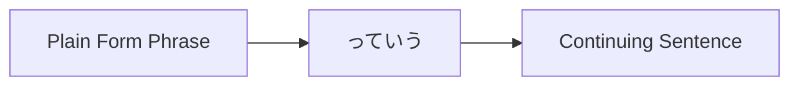
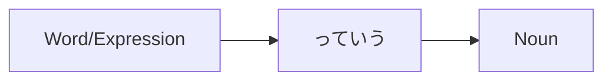

Processing keyword: ～っていう (〜tte iu)
# Điểm ngữ pháp tiếng Nhật: ～っていう (〜tte iu)

## 1. Giới thiệu
Diễn đạt **～っていう** (phát âm là *tte iu*) là một điểm ngữ pháp linh hoạt và thường được dùng trong tiếng Nhật. Nó thường xuất hiện trong các cuộc trò chuyện thân mật và có thể phục vụ nhiều chức năng, chẳng hạn như trích dẫn lời ai đó, định nghĩa hoặc đặt tên cho điều gì đó, hoặc nhấn mạnh một chủ đề. Hiểu cách dùng **～っていう** sẽ nâng cao khả năng tham gia các cuộc trò chuyện tiếng Nhật tự nhiên, hàng ngày của bạn.

---
## 2. Giải thích ngữ pháp cốt lõi
### Ý nghĩa
**～っていう** được dùng để:
- **Trích dẫn** điều ai đó đã nói hoặc nghĩ.
- **Nhắc đến** điều gì đó được gọi hoặc đặt tên theo một cách nhất định.
- **Nhấn mạnh** hoặc làm rõ một chủ đề hoặc khái niệm.
### Cấu trúc
Các cấu trúc cơ bản liên quan đến **～っていう** là:
1. **Trích dẫn lời nói hoặc suy nghĩ**
   ```
   [Phrase in plain form] + っていう
   ```
2. **Định nghĩa hoặc đặt tên**
   ```
   [Word/Expression] + っていう + [Noun]
   ```
3. **Nhấn mạnh một chủ đề**
   ```
   [Noun/Topic] + っていう + [Noun/Concept]
   ```
### Sơ đồ cấu trúc
#### 1. Trích dẫn lời nói hoặc suy nghĩ

#### 2. Định nghĩa hoặc đặt tên

---
## 3. Phân tích so sánh
**～っていう** vs **～という**
- **～という** là dạng trang trọng tương ứng của **～っていう**.
- **～っていう** thường được dùng hơn trong **lời nói thân mật**.
  
| Diễn đạt      | Mức độ trang trọng | Cách dùng                         |
|-----------------|-----------|-------------------------------|
| ～っていう       | Thân mật    | Ngôn ngữ nói, không trang trọng     |
| ～という         | Trang trọng    | Ngôn ngữ viết, trang trọng      |
---
## 4. Ví dụ trong ngữ cảnh
### 1. Trích dẫn lời nói hoặc suy nghĩ
- **Lời nói thân mật**
  - **Tiếng Nhật:** 明日、雨が降るっていう。
  - **Romaji:** Ashita, ame ga furu tte iu.
  - **Tiếng Việt:** "Người ta nói ngày mai trời sẽ mưa."
- **Lời nói thân mật**
  - **Tiếng Nhật:** 彼は行かないっていう。
  - **Romaji:** Kare wa ikanai tte iu.
  - **Tiếng Việt:** "Anh ấy nói anh ấy sẽ không đi."
### 2. Định nghĩa hoặc đặt tên
- **Giới thiệu một cái tên**
  - **Tiếng Nhật:** これは抹茶っていうお茶です。
  - **Romaji:** Kore wa matcha tte iu ocha desu.
  - **Tiếng Việt:** "Đây là loại trà gọi là matcha."
- **Giải thích một thuật ngữ**
  - **Tiếng Nhật:** 漫画っていうのは日本のコミックです。
  - **Romaji:** Manga tte iu no wa Nihon no komikku desu.
  - **Tiếng Việt:** "Cái mà chúng ta gọi là 'manga' là truyện tranh Nhật Bản."
### 3. Nhấn mạnh một chủ đề
- **Làm nổi bật một khái niệm**
  - **Tiếng Nhật:** 愛っていうのは難しいね。
  - **Romaji:** Ai tte iu no wa muzukashii ne.
  - **Tiếng Việt:** "Tình yêu thật khó, nhỉ?"
- **Thảo luận về một ý tưởng**
  - **Tiếng Nhật:** 時間っていうものは大切だ。
  - **Romaji:** Jikan tte iu mono wa taisetsu da.
  - **Tiếng Việt:** "Thời gian là điều quan trọng."
---
## 5. Ghi chú văn hóa
### Ý nghĩa văn hóa
Trong văn hóa Nhật Bản, giao tiếp gián tiếp thường được coi trọng. Dùng **～っていう** cho phép người nói:
- Giới thiệu quan điểm hoặc suy nghĩ một cách nhẹ nhàng.
- Trích dẫn người khác mà không khẳng định thông tin là sự thật tuyệt đối.
- Thêm một lớp khiêm tốn hoặc lịch sự bằng cách tránh những câu nói trực tiếp.
### Thành ngữ
- **っていうか (tte iu ka)**: Được dùng để tự sửa lời nói hoặc diễn đạt lại.
  - **Ví dụ:**
    - **Tiếng Nhật:** 彼は、っていうか、彼女も来ます。
    - **Romaji:** Kare wa, tte iu ka, kanojo mo kimasu.
    - **Tiếng Việt:** "Anh ấy sẽ, hay đúng hơn là, cô ấy cũng sẽ đến."
---
## 6. Lỗi thường gặp và mẹo
### Phân tích lỗi
- **Lạm dụng trong văn viết trang trọng**
  - *Lỗi:* Dùng **～っていう** trong các bài luận trang trọng hoặc tài liệu chính thức.
  - *Sửa:* Dùng **～という** thay thế.
- **Đặt sai vị trí cụm từ**
  - *Lỗi:* Đặt **～っていう** sai vị trí trong câu.
  - *Sửa:* Đảm bảo nó theo sau trực tiếp từ hoặc cụm từ mà nó bổ nghĩa.
### Chiến lược học tập
- **Mẹo ghi nhớ**
  - Hãy nghĩ **～っていう** như "they say" (người ta nói) hoặc "called" (gọi là) trong tiếng Anh.
  
- **Luyện tập chuyển đổi**
  - Chuyển câu từ **～という** sang **～っていう** để quen với các mức độ trang trọng.
---
## 7. Tóm tắt và ôn tập
### Điểm chính cần nhớ
- **～っていう** là một diễn đạt thân mật dùng để trích dẫn, định nghĩa hoặc nhấn mạnh.
- Nó là dạng không trang trọng tương ứng của **～という**.
- Thường được dùng trong lời nói, không phù hợp cho văn viết trang trọng.
### Bài kiểm tra nhanh
1. **Bạn dùng ～っていう để giới thiệu tên của một thứ gì đó như thế nào?**
   - *Đáp án:* `[Tên/Từ] + っていう + [Danh từ]`
2. **Chuyển câu trang trọng sau sang lời nói thân mật bằng ～っていう:**
   
   **Trang trọng:** これは寿司という料理です。
   
   - *Đáp án:* これは寿司っていう料理です。
3. **～っていう có phù hợp trong văn viết trang trọng không?**
   - *Đáp án:* Không, hãy dùng ～という trong các ngữ cảnh trang trọng.
---
Bằng cách hiểu và luyện tập **～っていう**, bạn sẽ có thể diễn đạt các trích dẫn, định nghĩa và sự nhấn mạnh một cách tự nhiên trong các cuộc trò chuyện tiếng Nhật hàng ngày.


---

© [Hoangchamchi.org](https://hoangchamchi.org)