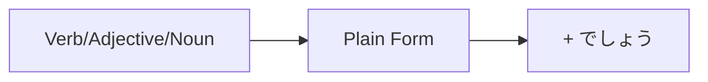

Processing keyword: ～でしょう (〜deshou)
# Điểm ngữ pháp tiếng Nhật: ～でしょう (〜deshou)

## 1. Giới thiệu
Điểm ngữ pháp **～でしょう** (〜deshou) là một diễn đạt linh hoạt trong tiếng Nhật dùng để chỉ xác suất, phỏng đoán hoặc tìm kiếm sự xác nhận. Nó thường được dịch là "có lẽ," "tôi nghĩ," hoặc "đúng không?" trong tiếng Anh. Hiểu cách dùng **～でしょう** đúng cách sẽ nâng cao khả năng diễn đạt sự không chắc chắn, đưa ra dự đoán và xác nhận thông tin trong cả ngữ cảnh trang trọng lẫn thân mật.

---
## 2. Giải thích ngữ pháp cốt lõi
### Ý nghĩa
- **Diễn đạt xác suất hoặc phỏng đoán:** Chỉ ra rằng điều gì đó có khả năng hoặc có lẽ là đúng.
- **Tìm kiếm sự xác nhận:** Được dùng ở cuối câu để hỏi sự đồng tình hoặc xác nhận, tương tự như "đúng không?" hoặc "phải không?" trong tiếng Anh.
### Cấu trúc
#### Cấu tạo
Cấu tạo của **～でしょう** phụ thuộc vào loại từ đứng sau nó:
| **Loại từ**     | **Thể thường**                | **+ でしょう**                         |
|-------------------|-------------------------------|---------------------------------------|
| Động từ              | 食べる (taberu) - ăn      | 食べる **でしょう** (taberu deshou)    |
| Tính từ い      | 高い (takai) - đắt      | 高い **でしょう** (takai deshou)       |
| Tính từ な      | 便利 **だ** (benri **da**) - tiện lợi | 便利 **でしょう** (benri deshou)   |
| Danh từ              | 学生 **だ** (gakusei **da**) - học sinh     | 学生 **でしょう** (gakusei deshou) |
- **Lưu ý:** Với **tính từ な** và **danh từ**, hệ từ **だ** thường được lược bỏ trong lời nói trang trọng.
---
### Minh họa: Sơ đồ cấu trúc

---
## 3. Phân tích so sánh
### ～でしょう vs. ～かもしれません
|                    | **～でしょう**                         | **～かもしれません**                    |
|--------------------|---------------------------------------|--------------------------------------|
| **Ý nghĩa**        | Có lẽ; Tôi nghĩ                    | Có thể; Có lẽ                          |
| **Mức độ chắc chắn**| Khả năng cao hơn                    | Khả năng thấp hơn                    |
| **Ví dụ**        | 雨が降る**でしょう**。 (Có lẽ trời sẽ mưa.) | 雨が降る**かもしれません**。 (Có thể trời sẽ mưa.) |
- **Khác biệt chính:** **～でしょう** diễn đạt mức độ chắc chắn cao hơn so với **～かもしれません**.
---
## 4. Ví dụ trong ngữ cảnh
### Lời nói trang trọng
1. **明日は寒くなるでしょう。**
   - *Ashita wa samuku naru deshou.*
   - "Ngày mai có lẽ trời sẽ trở lạnh."
2. **彼は今忙しいでしょうか。**
   - *Kare wa ima isogashii deshou ka.*
   - "Bạn có nghĩ anh ấy đang bận không?"
### Lời nói thân mật
1. **あの映画は面白いだろう。**
   - *Ano eiga wa omoshiroi darou.*
   - "Bộ phim đó có lẽ thú vị."
2. **疲れたでしょう？**
   - *Tsukareta deshou?*
   - "Bạn mệt rồi phải không?"
### Tìm kiếm sự xác nhận
1. **これはあなたの本でしょう？**
   - *Kore wa anata no hon deshou?*
   - "Đây là cuốn sách của bạn, đúng không?"
2. **彼女は日本に行くでしょうね。**
   - *Kanojo wa Nihon ni iku deshou ne.*
   - "Cô ấy sẽ đi Nhật Bản, đúng không?"
### Ngữ cảnh viết
1. **技術はさらに進歩するでしょう。**
   - *Gijutsu wa sara ni shinpo suru deshou.*
   - "Công nghệ có lẽ sẽ tiến bộ hơn nữa."
---
## 5. Ghi chú văn hóa
### Lịch sự và trang trọng
- **～でしょう** lịch sự và trang trọng hơn so với dạng thân mật tương ứng **～だろう**.
- Nó thường được dùng trong các cuộc hội thoại trang trọng, bản tin, dự báo thời tiết và các tương tác lịch sự hàng ngày.
- Trong văn viết, **～でしょう** thêm mức độ trang trọng và được ưa chuộng hơn **～だろう**.
### Thành ngữ
- **でしょうがない / しょうがない**
  - Mang nghĩa "không thể tránh được" hoặc "đó là điều tất yếu."
  - Ví dụ: **待つしかないでしょうがない。**
    - *Matsu shika nai deshou ga nai.*
    - "Chúng ta không còn cách nào khác ngoài chờ đợi."
---
## 6. Lỗi thường gặp và mẹo
### Lỗi thường gặp
1. **Dùng sai mức độ trang trọng**
   - Trộn **～でしょう** (trang trọng) với lời nói thân mật.
   - **Mẹo:** Dùng **～だろう** trong các ngữ cảnh thân mật với bạn bè hoặc gia đình.
2. **Nhầm lẫn với ～と思います (to omoimasu)**
   - **～と思います** mang nghĩa "tôi nghĩ," diễn đạt quan điểm cá nhân.
   - **Mẹo:** Hãy nhớ rằng **～でしょう** thường hàm ý phỏng đoán dựa trên một số bằng chứng hoặc kỳ vọng.
### Chiến lược học tập
- **Mẹo ghi nhớ:** Hãy nghĩ **でしょう** như "Deshou = Definitely shows uncertainty." (Chắc chắn thể hiện sự không chắc chắn.)
- **Luyện tập:** Tạo câu về các sự kiện tương lai bằng **～でしょう** để quen với việc diễn đạt xác suất.
---
## 7. Tóm tắt và ôn tập
### Điểm chính cần nhớ
- **～でしょう** được dùng để diễn đạt xác suất, phỏng đoán hoặc tìm kiếm sự xác nhận.
- Nó thêm sự lịch sự và trang trọng cho lời nói của bạn.
- Phân biệt **～でしょう** (trang trọng) và **～だろう** (thân mật).
- Nhớ sự khác biệt giữa **～でしょう** và **～かもしれません** về mức độ chắc chắn.
### Bài kiểm tra nhanh
1. **Bạn diễn đạt "Ngày mai có thể trời mưa" bằng **～でしょう** như thế nào?  
   A) 明日は雨が降るでしょう。  
   B) 明日は雨が降るかもしれません。
2. **Cái nào trang trọng hơn, ～でしょう hay ～だろう?**
3. **Dịch sang tiếng Nhật bằng **～でしょう**: "Anh ấy có lẽ là giáo viên."**
---
**Đáp án:**
1. **A) 明日は雨が降るでしょう。**
2. **～でしょう** trang trọng hơn.
3. **彼は先生でしょう。**  
   *Kare wa sensei deshou.*

---

© [Hoangchamchi.org](https://hoangchamchi.org)