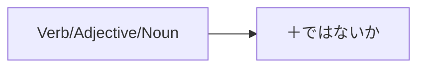

Processing keyword: ～ではないか (〜de wa nai ka)
# Điểm ngữ pháp tiếng Nhật: ～ではないか (〜de wa nai ka)

## 1. Giới thiệu
Diễn đạt **～ではないか (〜de wa nai ka)** là một cấu trúc ngữ pháp linh hoạt trong tiếng Nhật được dùng để:
- **Đưa ra đề nghị hoặc đề xuất**
- **Diễn đạt quan điểm hoặc khẳng định mạnh mẽ**
- **Tìm kiếm sự đồng tình hoặc xác nhận**
Nó thường được dịch thành các cụm từ như "Hãy...", "Phải không...", hoặc "Bạn có nghĩ... không" trong tiếng Anh. Hiểu điểm ngữ pháp này cho phép bạn diễn đạt bản thân một cách thuyết phục hơn và thu hút người khác vào cuộc trò chuyện.

---
## 2. Giải thích ngữ pháp cốt lõi
### Ý nghĩa và cách dùng
**～ではないか** được dùng để:
1. **Đề nghị một hành động**: Đề xuất điều gì đó với người khác theo cách quả quyết nhưng lịch sự.
   - *"Hãy..."*
2. **Diễn đạt một quan điểm**: Nêu quan điểm của bạn một cách mạnh mẽ, mong đợi sự đồng tình.
   - *"Phải không..." / "Bạn có nghĩ... không"*
3. **Nhấn mạnh một câu nói**: Làm nổi bật hoặc nhấn mạnh một điểm.
   - *"Chắc chắn..." / "Quả thực..."*
### Cấu tạo
Cấu tạo thay đổi một chút tùy theo việc bạn dùng động từ, tính từ hay danh từ.
#### Cấu trúc
| Từ loại   | Cấu tạo                              |
|------------------|----------------------------------------|
| **Động từ**         | **Động từ [dạng từ điển]** + ではないか   |
| **Tính từ い** | **Tính từ** + ではないか                |
| **Tính từ な** | **Tính từ** + ではないか                |
| **Danh từ**         | **Danh từ** + ではないか                    |
#### Sơ đồ cấu trúc

### Ví dụ
1. **Động từ**
   - 食べる **ではないか**
   - *Taberu de wa nai ka*
   - "Hãy ăn thôi, được chứ?"
2. **Tính từ い**
   - 速い **ではないか**
   - *Hayai de wa nai ka*
   - "Nhanh quá phải không?"
3. **Tính từ な**
   - 簡単 **ではないか**
   - *Kantan de wa nai ka*
   - "Đơn giản quá phải không?"
4. **Danh từ**
   - 彼 **ではないか**
   - *Kare de wa nai ka*
   - "Đó chẳng phải là anh ấy sao?"
---
## 3. Phân tích so sánh
### Các điểm ngữ pháp tương tự
| Điểm ngữ pháp       | Cách dùng                           | Mức độ trang trọng   |
|---------------------|---------------------------------|-------------|
| **～じゃないか**    | Dạng thân mật của **～ではないか** | Không trang trọng    |
| **～ましょう**      | "Hãy..." cho các đề nghị      | Trung tính     |
| **～と思う**        | "Tôi nghĩ..." cho các quan điểm       | Trung tính     |
### Khác biệt
- **～ではないか vs. ～じゃないか**
  - **～ではないか**: Trang trọng, dùng trong ngôn ngữ viết hoặc bài phát biểu trang trọng.
  - **～じゃないか**: Thân mật, phổ biến trong hội thoại hàng ngày.
- **～ではないか vs. ～ましょう**
  - **～ではないか**: Thuyết phục hơn, tìm kiếm sự đồng tình.
  - **～ましょう**: Đề nghị lịch sự mà không có sự thuyết phục mạnh.
---
## 4. Ví dụ trong ngữ cảnh
### Câu ví dụ
#### Đề nghị (Trang trọng)
1. **新しいプロジェクトを始めるではないか。**
   - *Atarashii purojekuto o hajimeru de wa nai ka.*
   - "Hãy bắt đầu một dự án mới."
#### Quan điểm/Khẳng định
2. **彼の意見は正しいではないか。**
   - *Kare no iken wa tadashii de wa nai ka.*
   - "Quan điểm của anh ấy đúng phải không?"
3. **これは重大な問題ではないか。**
   - *Kore wa jūdai na mondai de wa nai ka.*
   - "Đây chẳng phải là một vấn đề nghiêm trọng sao?"
#### Tìm kiếm sự đồng tình
4. **みんなで協力すれば、成功できるではないか。**
   - *Minna de kyōryoku sureba, seikō dekiru de wa nai ka.*
   - "Nếu tất cả chúng ta hợp tác, chúng ta có thể thành công, bạn có nghĩ vậy không?"
#### Nhấn mạnh một câu nói
5. **時間が足りないではないか。**
   - *Jikan ga tarinai de wa nai ka.*
   - "Chắc chắn, chúng ta không có đủ thời gian."
### Cách dùng trang trọng và thân mật
- **Trang trọng**
  - **Bài phát biểu của chính trị gia**: *国民の声を聞くべきではないか。*
    - "Chúng ta không nên lắng nghe tiếng nói của người dân sao?"
- **Thân mật**
  - **Hội thoại với bạn bè**: *今日は早く帰ろうじゃないか。*
    - "Hôm nay hãy về sớm thôi, được chứ?"
---
## 5. Ghi chú văn hóa
### Ý nghĩa văn hóa
- **Tính trang trọng trong ngôn ngữ**: Tiếng Nhật đặt tầm quan trọng lớn vào mức độ lịch sự và trang trọng. Dùng **～ではないか** thể hiện sự tôn trọng và phù hợp với các bối cảnh trang trọng như bài phát biểu, tranh luận hoặc thảo luận học thuật.
### Mức độ lịch sự
- **Trang trọng (～ではないか)**
  - Được dùng trong giao tiếp chính thức, nói trước công chúng, văn học.
  - Truyền đạt sự nghiêm túc và trang trọng.
- **Thân mật (～じゃないか)**
  - Phổ biến giữa bạn bè, gia đình, người ngang hàng.
  - Truyền đạt giọng điệu thân mật.
### Thành ngữ
- **言うまでもないではないか**
  - *Iu made mo nai de wa nai ka*
  - "Điều đó khỏi phải nói, đúng không?"
---
## 6. Lỗi thường gặp và mẹo
### Lỗi thường gặp
1. **Dùng sai mức độ trang trọng**
   - Trộn **～ではないか** trong các cuộc trò chuyện thân mật nơi **～じゃないか** phù hợp hơn.
2. **Chia sai**
   - Đặt sai vị trí **ではないか** hoặc gắn nó vào dạng động từ sai.
### Phân tích lỗi
- **Sai**: 食べますではないか。
  - *Gắn sai vào dạng động từ lịch sự.*
- **Đúng**: 食べるではないか。
  - *Gắn **ではないか** vào dạng từ điển.*
### Chiến lược học tập
- **Mẹo ghi nhớ**
  - **"Hãy nghĩ Trang trọng = De wa nai ka"**
- **Luyện tập chuyển đổi mức độ trang trọng**
  - Chuyển câu giữa **～ではないか** và **～じゃないか** để quen với cả hai dạng.
---
## 7. Tóm tắt và ôn tập
### Điểm chính cần nhớ
- **Cách dùng**: **～ではないか** được dùng để đưa ra đề nghị, diễn đạt quan điểm mạnh mẽ hoặc tìm kiếm sự đồng tình trong một ngữ cảnh trang trọng.
- **Cấu tạo**: Gắn **ではないか** vào dạng từ điển của động từ, tính từ hoặc danh từ.
- **Tính trang trọng quan trọng**: Chọn giữa **～ではないか** (trang trọng) và **～じゃないか** (thân mật) dựa trên ngữ cảnh.
### Bài kiểm tra nhanh
1. **Bạn nói "Thú vị quá phải không?" bằng ～ではないか như thế nào?**
   - **Đáp án**: 面白いではないか。
2. **Chuyển sang trang trọng:** *行こうじゃないか。*
   - **Đáp án**: 行こうではないか。
3. **Dạng thân mật tương đương của ～ではないか là gì?**
   - **Đáp án**: ～じゃないか
---
Bằng cách nắm vững **～ではないか**, bạn sẽ nâng cao khả năng giao tiếp trang trọng và thuyết phục trong tiếng Nhật. Hãy tiếp tục luyện tập và đừng ngần ngại sử dụng cấu trúc này trong các ngữ cảnh phù hợp!

---

© [Hoangchamchi.org](https://hoangchamchi.org)