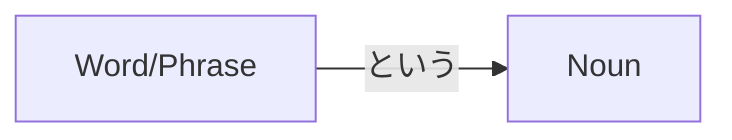

Processing keyword: ～という (〜to iu) Noun
# Điểm ngữ pháp tiếng Nhật: ～という (〜to iu) + Danh từ

## 1. Giới thiệu
Điểm ngữ pháp **～という (〜to iu)** là một cấu trúc nền tảng trong tiếng Nhật được dùng để định nghĩa hoặc mô tả một danh từ bằng cách xác định nó được gọi là gì. Nó được dịch là **"được gọi là," "tên là,"** hoặc **"mà được gọi là"** trong tiếng Anh. Cấu trúc này đặc biệt hữu ích khi giới thiệu các khái niệm mới, đồ vật mới, hoặc khi xác định chính xác người hoặc vật bạn đang nhắc đến.

---
## 2. Giải thích ngữ pháp cốt lõi
### Ý nghĩa
- **～という + Danh từ**: Một danh từ **được gọi là** ~; một danh từ **tên là** ~; một danh từ **mà được gọi là** ~
Cấu trúc này cho phép người nói cung cấp tên hoặc tiêu đề của một danh từ, giới thiệu hoặc xác định nó một cách hiệu quả.
### Cấu trúc
Cấu trúc cơ bản của điểm ngữ pháp này là:
```
[Word/Phrase] + という + Noun
```
- **[Từ/Cụm từ]**: Tên hoặc tiêu đề bạn muốn áp dụng cho danh từ.
- **という**: Cụm từ kết nối mang nghĩa **"được gọi là"** hoặc **"tên là."**
- **Danh từ**: Danh từ được định nghĩa hoặc mô tả.
### Sơ đồ cấu trúc

### Giải thích chi tiết
- **という** có nguồn gốc từ động từ **言う (いう)** mang nghĩa **"nói."**
- Khi được gắn vào một từ hoặc cụm từ, nó tạo ra một bổ ngữ mang nghĩa **"được gọi là"** hoặc **"tên là."**
- Cấu trúc này được dùng để:
  - Giới thiệu điều gì đó không quen thuộc với người nghe.
  - Xác định hoặc làm rõ danh từ bạn đang nói đến.
  - Đưa ra tiêu đề hoặc tên của một vật gì đó.
### Minh họa: Phân tích cấu trúc
| Thành phần         | Chức năng                      | Ví dụ              |
|-------------------|-------------------------------|----------------------|
| **Từ/Cụm từ**   | Tên hoặc tiêu đề                 | スシ (Sushi)         |
| **という**        | Bộ kết nối "Được gọi là"/"Tên là"    | という               |
| **Danh từ**          | Vật được mô tả     | 食べ物 (Đồ ăn)        |
| **Câu đầy đủ** | Ý hoàn chỉnh                 | スシという食べ物     |
| **Bản dịch**   |                               | Một món ăn gọi là sushi. |
---
## 3. Phân tích so sánh
### Các điểm ngữ pháp tương tự
#### **～と呼ばれる (〜とよばれる)**
- **Ý nghĩa**: "Được gọi là" hoặc "được biết đến là"
- **Cách dùng**: Trang trọng hơn; thường dùng trong ngôn ngữ viết hoặc bài phát biểu trang trọng.
- **Ví dụ**:
  - 東京は日本の首都と呼ばれる都市です。
    - *Tōkyō wa Nihon no shuto to yobareru toshi desu.*
    - Tokyo là một thành phố được gọi là thủ đô của Nhật Bản.
#### **～っていう**
- **Ý nghĩa**: Dạng thân mật của **という**, dùng trong ngôn ngữ nói.
- **Cách dùng**: Hội thoại thân mật giữa bạn bè hoặc người ngang hàng.
- **Ví dụ**:
  - スシっていう食べ物を知ってる？
    - *Sushi tte iu tabemono o shitteru?*
    - Bạn có biết một món ăn gọi là sushi không?
### Sắc thái
- **という** trung tính và có thể dùng trong cả ngữ cảnh trang trọng lẫn thân mật.
- **～と呼ばれる** trang trọng hơn và thường dùng để giới thiệu các định nghĩa hoặc chức danh chính thức.
- **～っていう** thân mật và thường dùng trong lời nói hàng ngày.
---
## 4. Ví dụ trong ngữ cảnh
### Câu ví dụ
#### **Ví dụ 1: Giới thiệu một thuật ngữ mới**
- **Tiếng Nhật**: これは **ラーメン** という食べ物です。
- **Romaji**: Kore wa **rāmen** to iu tabemono desu.
- **Tiếng Việt**: Đây là một món ăn gọi là **ramen**.
#### **Ví dụ 2: Xác định một người**
- **Tiếng Nhật**: **田中さん** という人が訪ねてきました。
- **Romaji**: **Tanaka-san** to iu hito ga tazunete kimashita.
- **Tiếng Việt**: Một người tên là **ông Tanaka** đã đến thăm.
#### **Ví dụ 3: Mô tả một địa điểm**
- **Tiếng Nhật**: 京都には **金閣寺** というお寺があります。
- **Romaji**: Kyōto ni wa **Kinkaku-ji** to iu otera ga arimasu.
- **Tiếng Việt**: Ở Kyoto có một ngôi chùa gọi là **Kinkaku-ji**.
#### **Ví dụ 4: Nói về một cuốn sách**
- **Tiếng Nhật**: **「星の王子さま」** という本を読みました。
- **Romaji**: **"Hoshi no Ōjisama"** to iu hon o yomimashita.
- **Tiếng Việt**: Tôi đã đọc một cuốn sách gọi là **"Hoàng tử bé."**
#### **Ví dụ 5: Hội thoại thân mật**
- **Tiếng Nhật**: 明日、 **花火大会** というイベントに行くよ。
- **Romaji**: Ashita, **hanabi taikai** to iu ibento ni iku yo.
- **Tiếng Việt**: Ngày mai tôi sẽ đến một sự kiện gọi là **lễ hội pháo hoa**.
---
## 5. Ghi chú văn hóa
### Ý nghĩa văn hóa
- **Sự rõ ràng trong giao tiếp**: Trong văn hóa Nhật Bản, việc giao tiếp rõ ràng và cung cấp bối cảnh là quan trọng, đặc biệt khi giới thiệu các thuật ngữ không quen thuộc.
- **Sự lịch sự**: Dùng **という** thể hiện sự cân nhắc bằng cách giải thích hoặc xác định rõ, phù hợp với giá trị lịch sự và quan tâm đến kiến thức của người nghe trong văn hóa Nhật.
### Mức độ lịch sự và trang trọng
- Cấu trúc cơ bản **という** trung tính.
- Độ lịch sự được điều chỉnh bởi đuôi động từ và trợ từ dùng trong câu.
  - Thân mật: だ (da), する (suru)
  - Lịch sự: です (desu), します (shimasu)
### Thành ngữ
#### **名は体を表す (なはたいをあらわす)**
- **Ý nghĩa**: "Tên phản ánh bản chất" hoặc "Tên và bản chất thường khớp nhau."
- **Cách dùng**: Nhấn mạnh tầm quan trọng của việc tên gọi phản ánh bản chất thực sự của một vật.
#### **「猫」という動物**
- Thường được dùng trong các ngữ cảnh giáo dục để định nghĩa hoặc dạy về một chủ đề.
  - **Ví dụ**: **猫という動物はとてもかわいいです。**
    - *Loài vật gọi là mèo rất đáng yêu.*
---
## 6. Lỗi thường gặp và mẹo
### Phân tích lỗi
#### **Lỗi 1: Bỏ sót danh từ**
- **Sai**: これは **スシという** 。
  - Thiếu danh từ sau **という**.
- **Đúng**: これは **スシという食べ物** です。
#### **Lỗi 2: Đặt sai vị trí cấu trúc**
- **Sai**: **というスシ食べ物**。
  - **という** nên đứng sau **スシ**.
- **Đúng**: **スシという食べ物**。
#### **Lỗi 3: Dùng **と** thay vì **という**
- **Sai**: **スシと食べ物**。
- **Đúng**: **スシという食べ物**。
### Chiến lược học tập
#### **Mẹo 1: Hãy nghĩ **という** như "Được gọi là"**
- Khi bạn thấy **という**, hãy thay nó bằng "được gọi là" trong đầu để hiểu câu.
#### **Mẹo 2: Luyện tập với các từ quen thuộc**
- Tạo câu dùng **という** với những cái tên bạn quen thuộc.
  - **Ví dụ**: **ポケモンというゲーム** (Một trò chơi gọi là Pokémon)
#### **Mẹo 3: Dùng thẻ ghi nhớ**
- Viết các câu sử dụng **という** để củng cố cấu trúc.
---
## 7. Tóm tắt và ôn tập
### Điểm chính cần nhớ
- **～という** được dùng để định nghĩa hoặc mô tả một danh từ bằng tên hoặc tiêu đề của nó.
- Cấu trúc: **[Từ/Cụm từ] + という + Danh từ**
- Nó được dịch là "một danh từ **được gọi là** ~" hoặc "một danh từ **tên là** ~."
- Hữu ích để giới thiệu các khái niệm mới hoặc xác định các danh từ cụ thể.
### Bài kiểm tra nhanh
1. **Bạn nói "Một bài hát gọi là 'Sakura'" trong tiếng Nhật như thế nào?**
   - **Đáp án**: **「さくら」という歌**
2. **Điền vào chỗ trống: 彼は _____ という会社で働いています。 (Anh ấy làm việc tại một công ty gọi là 'ABC Corp.')**
   - **Đáp án**: **「ABCコーポレーション」**
3. **Đúng hay Sai: Cấu trúc **という** có thể dùng để truyền đạt lời đồn hoặc những điều bạn đã nghe.**
   - **Đáp án**: **Sai** (Đó là chức năng của **～そうです** hoặc **～らしい**.)
---
Bằng cách hiểu và luyện tập cấu trúc **～という**, bạn sẽ có thể giới thiệu và mô tả mọi thứ một cách tự nhiên hơn trong tiếng Nhật, nâng cao cả kỹ năng nói và hiểu của bạn. Hãy nhớ chú ý đến vị trí của **という** và đảm bảo rằng bạn bao gồm cả tên/tiêu đề và danh từ mà nó mô tả.


---

© [Hoangchamchi.org](https://hoangchamchi.org)