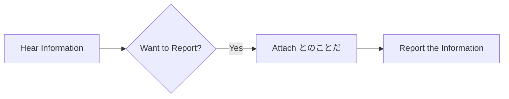

Processing keyword: ～とのことだ (〜to no koto da)
# Điểm ngữ pháp tiếng Nhật: ～とのことだ (〜to no koto da)

## 1. Giới thiệu
Điểm ngữ pháp ～とのことだ (〜to no koto da) được dùng trong tiếng Nhật để chuyển tải thông tin đã nghe được từ người khác. Nó thường được dùng để tường thuật lời đồn hoặc truyền đạt tin nhắn một cách gián tiếp, khiến nó trở thành một cấu trúc hữu ích trong cả giao tiếp trang trọng lẫn thân mật.

---
## 2. Giải thích ngữ pháp cốt lõi
### Ý nghĩa
- **～とのことだ** được dùng để **tường thuật thông tin** mà bạn đã nghe từ một **nguồn cụ thể**.
- Nó được dịch gần đúng là **"I've heard that..."** (Tôi nghe nói rằng...) hoặc **"It is said that..."** (Người ta nói rằng...).
### Cấu trúc
Cấu trúc bao gồm việc gắn **とのことだ** vào **thể thường** của một động từ, tính từ hoặc mệnh đề danh từ.
### Sơ đồ cấu trúc
| **Loại mệnh đề**       | **Cách hình thành**                   |
|-----------------------|---------------------------------|
| **Động từ (Thể thường)** | **Động từ** + とのことだ           |
| **Tính từ い**      | **Tính từ い** + とのことだ         |
| **Tính từ な**      | **Tính từ な** + とのことだ         |
| **Danh từ**              | **Danh từ** + とのことだ           |
### Phân tích thành phần
- **との**: Trợ từ と (trợ từ trích dẫn) + の (trợ từ sở hữu)
- **こと**: Sự việc, điều
- **だ**: Trợ từ liên kết (to be)
### Giải thích chi tiết
- **とのことだ** kết hợp **と** (chỉ sự trích dẫn hoặc lời nói được tường thuật) với **のことだ**, nhấn mạnh sự việc hoặc nội dung của điều đã được nói.
- Nó thường được dùng khi người nói muốn truyền đạt thông tin mà không khẳng định đó là sự thật, thể hiện mức độ tách rời hoặc trang trọng.
### Minh họa: Sơ đồ luồng sử dụng

---
## 3. Phân tích so sánh
### ～そうだ vs. ～とのことだ
|               | **～そうだ**                   | **～とのことだ**                   |
|---------------|-------------------------------|------------------------------------|
| **Cách dùng**     | Lời đồn & Phỏng đoán          | Lời đồn từ một nguồn cụ thể     |
| **Trang trọng** | Có thể thân mật               | Trang trọng hơn                        |
| **Sắc thái**    | Có thể hàm ý sự không chắc chắn         | Truyền đạt thông tin nghe trực tiếp |
- **Ví dụ**:  
  - ～そうだ: 雨が降るそうだ。(*Tôi nghe nói trời có thể mưa.*)
  - ～とのことだ: 部長は遅れるとのことだ。(*Tôi được báo rằng trưởng phòng sẽ đến muộn.*)
---
## 4. Ví dụ trong ngữ cảnh
### Câu ví dụ
1. **Trang trọng - Bối cảnh kinh doanh**
   - 彼は来月転勤するとのことです。
     - *Tôi nghe nói anh ấy sẽ được điều chuyển vào tháng sau.*
2. **Hội thoại thân mật**
   - 山田さんは元気だとのことだよ。
     - *Tôi nghe nói Yamada-san vẫn khỏe.*
3. **Giao tiếp bằng văn viết**
   - お客様からお電話があり、少し遅れるとのことでした。
     - *Có cuộc gọi từ khách hàng; họ nói sẽ đến muộn một chút.*
4. **Tường thuật tin tức**
   - 新しいプロジェクトが始まるとのことだ。
     - *Người ta nói rằng một dự án mới sẽ bắt đầu.*
5. **Thông tin từ bên thứ ba**
   - 天気予報によると、明日は雪になるとのことだ。
     - *Theo dự báo thời tiết, người ta nói rằng ngày mai trời sẽ có tuyết.*
---
## 5. Ghi chú văn hóa
### Tính liên quan văn hóa
- **Lịch sự và trang trọng**: Dùng **～とのことだ** thêm một lớp trang trọng và tách rời, phù hợp trong bối cảnh kinh doanh hoặc giao tiếp trang trọng.
- **Tính gián tiếp**: Phản ánh phong cách giao tiếp gián tiếp của người Nhật, thể hiện sự tôn trọng và lịch sự.
### Các cụm từ thành ngữ
- **お疲れ様とのことです**: *Anh ấy/Cô ấy gửi lời cảm ơn vì sự vất vả của bạn.*
- **よろしくとのことだ**: *Anh ấy/Cô ấy gửi lời hỏi thăm.*
---
## 6. Lỗi thường gặp và mẹo
### Phân tích lỗi
- **Dùng ～とのことだ trong các ngữ cảnh thân mật**: Lạm dụng trong các tình huống thân mật có thể nghe quá trang trọng hoặc xa cách.
  - **Mẹo**: Trong các cuộc trò chuyện thân mật, hãy cân nhắc dùng **～って** hoặc **～だそうだ** thay thế.
- **Nhầm lẫn với ～ということだ**
  - **Khác biệt**:
    - **～ということだ** có thể mang nghĩa lời đồn hoặc kết luận.
    - **～とのことだ** chỉ dùng để tường thuật thông tin đã nghe.
### Chiến lược học tập
- **Mẹo ghi nhớ**: Hãy nghĩ **との** như "với" nội dung (**のこと**) của điều đã được nói (**と**).
- **Luyện tập**: Tạo các câu tường thuật các loại thông tin khác nhau để quen với cấu trúc.
---
## 7. Tóm tắt và ôn tập
### Những điểm chính
- **～とのことだ** được dùng để tường thuật thông tin nghe được từ một nguồn cụ thể.
- Thêm tính trang trọng và phù hợp với giao tiếp trang trọng bằng văn viết và lời nói.
- Nên được dùng một cách phù hợp để khớp với mức độ trang trọng của ngữ cảnh.
### Bài kiểm tra nhanh
1. **Cách dùng chính của ～とのことだ là gì?**
   - a) Diễn đạt ý định của bản thân.
   - b) Tường thuật lời đồn từ một nguồn cụ thể.
   - c) Phỏng đoán về tương lai.
2. **Cái nào trang trọng hơn, ～そうだ hay ～とのことだ?**
3. **Điền vào chỗ trống**: 田中さんは今日休む_____。
   - (*Gợi ý*: Dùng ～とのことだ để tường thuật rằng Tanaka-san sẽ nghỉ hôm nay.)
### Đáp án:
1. **b) Tường thuật lời đồn từ một nguồn cụ thể.**
2. **～とのことだ trang trọng hơn.**
3. **田中さんは今日休むとのことだ。**
---
Bằng cách hiểu và sử dụng **～とのことだ** một cách phù hợp, bạn có thể truyền đạt thông tin được tường thuật một cách hiệu quả, vừa lịch sự vừa phù hợp về mặt văn hóa trong tiếng Nhật.

---

© [Hoangchamchi.org](https://hoangchamchi.org)