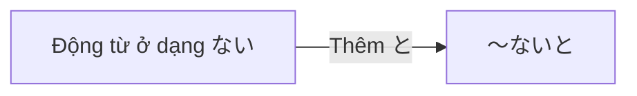

Processing keyword: ～ないと (〜nai to)
# Điểm ngữ pháp tiếng Nhật: ～ないと (〜nai to)

## 1. Giới thiệu
Điểm ngữ pháp **～ないと (〜nai to)** là một cách diễn đạt thông tục được dùng trong tiếng Nhật để chỉ sự bắt buộc hoặc cần thiết. Nó truyền đạt nghĩa "phải làm gì đó" hoặc "bắt buộc phải làm gì đó" và thường được dùng trong tiếng Nhật nói.

---
## 2. Giải thích ngữ pháp cốt lõi
### Ý nghĩa
**～ないと** diễn đạt ý thức về bổn phận hoặc sự cần thiết phải thực hiện một hành động. Nó có thể được dịch là:
- "I have to ~" (Tôi phải ~)
- "I must ~" (Tôi bắt buộc phải ~)
- "I need to ~" (Tôi cần ~)
### Cấu trúc
Cấu trúc bao gồm việc gắn **と** vào dạng phủ định thường của động từ (dạng ない):
```
Động từ (dạng ない) + と
```
### Sơ đồ cấu trúc
| Dạng từ điển của động từ | Dạng ない của động từ | ＋ と | Ý nghĩa              |
|----------------------|----------------|------|----------------------|
| 行く (iku)           | 行かない       | 行かないと  | Tôi phải đi        |
| 食べる (taberu)      | 食べない       | 食べないと  | Tôi phải ăn       |
| 勉強する (benkyou suru)| 勉強しない   | 勉強しないと| Tôi phải học     |
### Minh họa: Sơ đồ hình thành

---
## 3. Phân tích so sánh
### ～なければならない (nakereba naranai)
**Ý nghĩa**: Phải làm ~; bắt buộc phải làm ~
- **Cách dùng**: Cách diễn đạt bắt buộc trang trọng hơn.
- **So sánh**: ～ないと thân mật hơn và thường được dùng trong ngôn ngữ nói, trong khi ～なければならない trang trọng và được dùng trong ngữ cảnh viết hoặc trang trọng.
**Ví dụ**:
- 行かなければならない。(Tôi phải đi.) – Trang trọng
- 行かないと。(Tôi phải đi.) – Thân mật
### ～なくちゃ (nakucha) / ～なきゃ (nakya)
**Ý nghĩa**: Phải làm ~; bắt buộc phải làm ~
- **Cách dùng**: Rất thân mật, thường được dùng trong tiếng Nhật nói không trang trọng.
- **So sánh**: Mức độ thân mật tương tự ～ないと, nhưng có những khác biệt nhỏ về cách dùng theo vùng miền và sở thích cá nhân.
**Ví dụ**:
- 行かなくちゃ。(Tôi phải đi.)
- 行かなきゃ。(Tôi phải đi.)
---
## 4. Ví dụ trong ngữ cảnh
### Câu ví dụ
1. **早く寝ないと。**
   *Tôi phải đi ngủ sớm.*
2. **宿題をしないと。**
   *Tôi phải làm bài tập về nhà.*
3. **買い物に行かないといけない。**
   *Tôi phải đi mua sắm.*
4. **今日中にこのレポートを終わらせないと。**
   *Tôi phải hoàn thành bản báo cáo này trong hôm nay.*
5. **もう帰らないと。**
   *Bây giờ tôi phải về nhà.*
### Biến thể về mức độ trang trọng
- **Nói thân mật**: 行かないと。(Tôi phải đi.)
- **Nói/viết trang trọng**: 行かなければなりません。(Tôi phải đi.)
---
## 5. Ghi chú văn hóa
### Mức độ lịch sự
Trong văn hóa Nhật Bản, mức độ lịch sự và trang trọng là điều thiết yếu trong giao tiếp. Dùng **～ないと** chỉ ra một giọng điệu thân mật và thân thiện, phù hợp giữa bạn bè, gia đình hoặc người ngang hàng.
- **Dùng thận trọng**: Tránh dùng **～ないと** trong các tình huống trang trọng, bối cảnh kinh doanh hoặc với cấp trên. Thay vào đó, hãy chọn **～なければなりません** cho các ngữ cảnh trang trọng.
### Các cụm từ thành ngữ
- **忘れないと。**
  *Tôi không được quên.*
- **連絡しないと。**
  *Tôi phải liên lạc.*
---
## 6. Lỗi thường gặp và mẹo
### Lỗi thường gặp
1. **Dùng ～ないと trong các tình huống trang trọng**
   - Sai: 明日の会議に行かないと。(Tôi phải đi họp ngày mai.)
   - Sửa lại: 明日の会議に行かなければなりません。
   *Mẹo*: Dùng các cách diễn đạt trang trọng như **～なければなりません** trong các ngữ cảnh trang trọng.
2. **Nhầm lẫn với câu điều kiện phủ định**
   - Hiểu sai: 行かないといけない。(Tôi phải đi.) vs. 行かないと、困る。(Nếu tôi không đi, sẽ có vấn đề.)
   *Mẹo*: Chú ý đến ngữ cảnh để phân biệt sự bắt buộc với câu điều kiện.
### Chiến lược học tập
- **Mẹo ghi nhớ**: Hãy nghĩ **～ないと** như "Nếu tôi không ~, (sẽ có hậu quả)" được rút gọn thành "Tôi phải ~".
- **Luyện tập**: Tạo các câu về công việc hằng ngày dùng **～ないと** để quen với cách dùng thân mật của nó.
---
## 7. Tóm tắt và ôn tập
### Những điểm chính
- **～ないと** là một cách diễn đạt thân mật mang nghĩa "phải ~" hoặc "bắt buộc ~".
- Được hình thành bằng cách thêm **と** vào dạng phủ định của động từ.
- Được dùng trong tiếng Nhật nói thân mật giữa bạn bè và người ngang hàng.
- Các lựa chọn trang trọng hơn bao gồm **～なければならない**.
### Bài kiểm tra nhanh
1. **Bạn nói "I have to study" (Tôi phải học) bằng ～ないと như thế nào?**
   a) 勉強しないと。
   b) 勉強したいと。
   c) 勉強しなければ。
2. **Dạng nào trang trọng hơn?**
   a) 行かないと。
   b) 行かなければなりません。
3. **Đúng hay Sai:** ～ないと nên được dùng trong email kinh doanh.
### Đáp án
1. **a) 勉強しないと。**
2. **b) 行かなければなりません。**
3. **Sai**


---

© [Hoangchamchi.org](https://hoangchamchi.org)