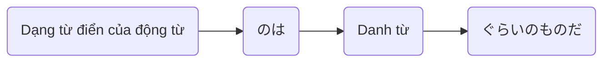

Processing keyword: ～のは Noun ぐらいのものだ (〜no wa 〜 gurai no mono da)
# Điểm ngữ pháp tiếng Nhật: ～のは Noun ぐらいのものだ (〜no wa 〜 gurai no mono da)

## 1. Giới thiệu
Trong bài học này, chúng ta sẽ khám phá điểm ngữ pháp **～のは Noun ぐらいのものだ**. Cấu trúc này được dùng để diễn đạt rằng chỉ một người hoặc một vật cụ thể đáp ứng một điều kiện nhất định hoặc có khả năng làm một điều gì đó. Đó là một cách để nhấn mạnh tính độc nhất hoặc độc quyền trong một phát biểu.
## 2. Giải thích ngữ pháp cốt lõi
### Giải thích chi tiết
Mẫu ngữ pháp **～のは Noun ぐらいのものだ** được dùng để truyền đạt rằng một điều gì đó được giới hạn độc quyền cho một danh từ cụ thể. Nó nhấn mạnh rằng *chỉ* danh từ đó phù hợp với mô tả hoặc có thể thực hiện hành động được chỉ định.
### Ý nghĩa
- **Tương đương tiếng Anh**: "Only (Noun) can..." (Chỉ (Danh từ) mới có thể...), "It's only (Noun) that..." (Chỉ có (Danh từ) là...), "No one but (Noun)..." (Không ai ngoài (Danh từ)...)
- **Chức năng**: Nhấn mạnh tính độc quyền hoặc độc nhất.
### Cấu trúc
#### Sơ đồ cấu trúc
| Thành phần          | Vai trò                                   |
|--------------------|----------------------------------------|
| **Động từ (dạng từ điển) のは** | Danh từ hóa động từ (biến hành động thành danh từ) |
| **Danh từ**           | Thực thể/người độc quyền            |
| **ぐらいのものだ**        | "là người/vật duy nhất"                |
#### Minh họa

## 3. Phân tích so sánh
Điểm ngữ pháp này tương tự như **～しかない**, cũng chỉ "chỉ" hoặc "không gì ngoài". Tuy nhiên, **～のは Noun ぐらいのものだ** có sự nhấn mạnh mạnh hơn về tính độc quyền và thường được dùng để làm nổi bật rằng một điều gì đó là đặc biệt hoặc hiếm.
| Điểm ngữ pháp                | Cách dùng                             | Ví dụ                                   |
|------------------------------|-----------------------------------|-------------------------------------------|
| ～のは Noun ぐらいのものだ         | Chỉ Danh từ mới có thể...                 | 彼ができるのはプロぐらいのものだ。             |
| ～しかない                    | Không có gì ngoài...           | ここには水しかない。                       |
## 4. Ví dụ trong ngữ cảnh
### Câu ví dụ
1. **彼が問題を解けるのは天才ぐらいのものだ。**
   - *Kare ga mondai o tokeru no wa tensai gurai no mono da.*
   - "Chỉ có thiên tài như anh ấy mới giải được bài toán này."
2. **こんな難しい曲を演奏できるのは彼女ぐらいのものだ。**
   - *Konna muzukashii kyoku o ensō dekiru no wa kanojo gurai no mono da.*
   - "Cô ấy gần như là người duy nhất có thể biểu diễn một bản nhạc khó như vậy."
3. **私が信用できるのは君ぐらいのものだ。**
   - *Watashi ga shin'yō dekiru no wa kimi gurai no mono da.*
   - "Bạn là người duy nhất tôi có thể tin tưởng."
4. **この料理を作れるのはプロのシェフぐらいのものだ。**
   - *Kono ryōri o tsukureru no wa puro no shefu gurai no mono da.*
   - "Chỉ có đầu bếp chuyên nghiệp mới làm được món ăn này."
5. **彼と対等に戦えるのは彼女ぐらいのものだろう。**
   - *Kare to taitō ni tatakaeru no wa kanojo gurai no mono darō.*
   - "Cô ấy có lẽ là người duy nhất có thể chiến đấu ngang tài với anh ấy."
## 5. Ghi chú văn hóa
### Tính liên quan văn hóa
Trong văn hóa Nhật Bản, việc diễn đạt sự khiêm tốn và công nhận sự độc nhất của người khác được coi trọng. Dùng điểm ngữ pháp này có thể làm nổi bật sự tôn trọng đối với khả năng đặc biệt của ai đó hoặc sự hiếm có của một tình huống.
### Các cụm từ thành ngữ
- **それができるのは彼ぐらいのものだ。**
  - Một cách thành ngữ để thừa nhận khả năng độc nhất của ai đó.
## 6. Lỗi thường gặp và mẹo
### Phân tích lỗi
- **Lỗi**: Bỏ sót **のは**, vốn rất quan trọng để danh từ hóa động từ và nối nó với danh từ.
  - *Sai*: 彼ができるぐらいのものだ。
  - *Đúng*: 彼ができる**のは**プロぐらいのものだ。
- **Lỗi**: Dùng **だけ** thay vì **ぐらいのものだ**, làm thay đổi sắc thái.
  - *Sai*: 彼女だけがこの仕事をできる。
  - *Đúng*: この仕事をできるのは彼女ぐらいのものだ。
### Chiến lược học tập
- **Mẹo ghi nhớ**: Hãy nghĩ **ぐらい** như "khoảng" và **のものだ** như "người duy nhất", vì vậy cùng nhau chúng nhấn mạnh "chỉ khoảng (Danh từ) là người duy nhất".
- **Luyện tập**: Tạo các câu của riêng bạn bằng cách xác định các khả năng hoặc tình huống độc nhất.
## 7. Tóm tắt và ôn tập
### Những điểm chính
- **～のは Noun ぐらいのものだ** nhấn mạnh rằng chỉ một danh từ cụ thể phù hợp với điều kiện.
- Nó làm nổi bật tính độc nhất hoặc độc quyền.
- Cấu trúc đúng rất quan trọng: Động từ (dạng từ điển) **のは** Danh từ **ぐらいのものだ**.
### Bài kiểm tra nhanh
1. **ぐらいのものだ** hàm ý điều gì trong cấu trúc ngữ pháp này?
2. Chuyển đổi câu sau dùng **～のは Noun ぐらいのものだ**:
   - "Only professionals can understand this code." (Chỉ các chuyên gia mới hiểu được mã này.)
   - *Đáp án*: このコードを理解できるのはプロフェッショナルぐらいのものだ。
3. Xác định lỗi trong câu này:
   - 彼が解決できるのは彼女ぐらいものだ。
   - *Đáp án*: Thiếu **の** sau **ぐらい**. Câu đúng: 彼が解決できるのは彼女ぐらい**の**ものだ。

---
Bằng cách hiểu và luyện tập điểm ngữ pháp này, bạn sẽ có thể diễn đạt tính độc quyền và làm nổi bật tính độc nhất một cách hiệu quả trong tiếng Nhật.

---

© [Hoangchamchi.org](https://hoangchamchi.org)