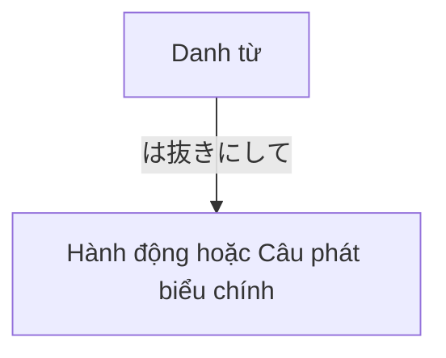

Processing keyword: ～は抜きにして (〜wa nuki ni shite)
# Điểm ngữ pháp tiếng Nhật: ～は抜きにして (〜wa nuki ni shite)

## 1. Giới thiệu
Trong bài học này, chúng ta sẽ tìm hiểu điểm ngữ pháp tiếng Nhật **～は抜きにして (〜wa nuki ni shite)**, được dịch sang tiếng Anh là "**gác sang một bên...**", "**không có...**" hoặc "**bỏ qua...**". Biểu thức này hữu ích khi bạn muốn tiến hành mà không xét đến một yếu tố cụ thể nào đó hoặc khi bạn muốn tập trung vào điều quan trọng bằng cách loại trừ một số yếu tố khỏi cuộc thảo luận.

---
## 2. Giải thích ngữ pháp cốt lõi
### Ý nghĩa
- **～は抜きにして**: *Gác sang một bên...*, *không có...*, *bỏ qua...*
Cụm từ này được dùng để loại trừ một chủ đề hoặc yếu tố cụ thể khỏi sự cân nhắc, cho phép cuộc trò chuyện hoặc hành động tập trung vào các khía cạnh khác.
### Cấu trúc
#### Sơ đồ cấu tạo

#### Cách tạo
- **Danh từ + は抜きにして + Hành động/Câu phát biểu chính**
**Các thành phần:**
1. **Danh từ**: Yếu tố bạn muốn gác sang một bên hoặc loại trừ.
2. **は (wa)**: Trợ từ đánh dấu chủ đề.
3. **抜きにして (nuki ni shite)**: Cụm từ mang nghĩa "bỏ qua" hoặc "không có".
### Giải thích chi tiết
Cụm từ **～は抜きにして** được tạo bằng cách lấy một danh từ (chủ đề cần loại trừ) và gắn **は抜きにして** vào. Cách này cho người nghe biết rằng bạn đang gác danh từ đó sang một bên và tiến hành mà không xét đến nó.
- **Phân tích ví dụ:**
  - **冗談は抜きにして、仕事に取り掛かりましょう。**
    - *Jōdan wa nuki ni shite, shigoto ni torikakarimashō.*
    - "Bỏ chuyện đùa sang một bên, bắt tay vào việc thôi."
  - **冗談 (jōdan)**: Chuyện đùa
  - **は (wa)**: Trợ từ chủ đề
  - **抜きにして (nuki ni shite)**: Gác sang một bên
  - **仕事に取り掛かりましょう (shigoto ni torikakarimashō)**: Bắt tay vào việc thôi
---
## 3. Phân tích so sánh
### Các điểm ngữ pháp tương tự
| Điểm ngữ pháp         | Ý nghĩa                      | Khác biệt về sắc thái                                                                                             |
| --------------------- | ---------------------------- | ------------------------------------------------------------------------------------------------------------- |
| **～を抜きにして**     | Không có..., loại trừ...      | Dùng **を** thay vì **は**, làm thay đổi nhẹ trọng tâm sang tân ngữ trực tiếp bị loại trừ.                  |
| **～はさておき**       | Gác sang một bên..., ngoài... | Gợi ý việc hoãn thảo luận về chủ đề; thường dùng để chuyển cuộc trò chuyện sang chủ đề khác.     |
| **～を除いて**         | Ngoại trừ..., loại trừ...    | Trang trọng hơn; trực tiếp nêu việc loại trừ một thứ khỏi một nhóm hoặc danh sách.                                 |
---
## 4. Ví dụ trong ngữ cảnh
### Ví dụ câu
#### **1. Trang trọng**
- **結果は抜きにして、努力を評価します。**
  - *Kekka wa nuki ni shite, doryoku o hyōka shimasu.*
  - "Gác kết quả sang một bên, chúng tôi sẽ đánh giá nỗ lực."
#### **2. Thân mật**
- **冗談は抜きにして、本題に入ろう。**
  - *Jōdan wa nuki ni shite, hondai ni hairō.*
  - "Bỏ chuyện đùa sang một bên, vào vấn đề chính thôi."
#### **3. Nói**
- **予算は抜きにして、いいアイデアを出してください。**
  - *Yosan wa nuki ni shite, ii aidea o dashite kudasai.*
  - "Quên ngân sách đi; xin hãy đưa ra những ý tưởng hay."
#### **4. Viết**
- **感情は抜きにして、客観的に判断するべきだ。**
  - *Kanjō wa nuki ni shite, kyakkan-teki ni handan subeki da.*
  - "Gác cảm xúc sang một bên, chúng ta nên phán đoán một cách khách quan."
---
## 5. Ghi chú văn hóa
### Sự liên quan về văn hóa
Trong văn hóa Nhật Bản, việc duy trì sự hài hòa và tập trung vào mục tiêu chung hơn cảm xúc cá nhân là điều quan trọng. Dùng **～は抜きにして** cho phép người nói nhẹ nhàng gác các vấn đề cá nhân hoặc các chủ đề ít liên quan sang một bên để tập trung vào điều quan trọng, phù hợp với sự nhấn mạnh của văn hóa vào sự gắn kết nhóm và hiệu quả.
### Lịch sự và trang trọng
- Biểu thức này linh hoạt và có thể dùng trong cả bối cảnh trang trọng và thân mật.
- Điều chỉnh mức độ lịch sự bằng cách thay đổi động từ và cụm từ theo sau **～は抜きにして**.
### Thành ngữ
- **冗談は抜きにして** (*Jōdan wa nuki ni shite*): "Bỏ chuyện đùa sang một bên"
- **個人的な意見は抜きにして** (*Kojin-teki na iken wa nuki ni shite*): "Gác ý kiến cá nhân sang một bên"
Những cách dùng thành ngữ này phổ biến trong cả trò chuyện kinh doanh và thường ngày.
---
## 6. Lỗi thường gặp và mẹo
### Phân tích lỗi
1. **Dùng sai trợ từ**
   - **Sai:** *冗談を抜きにして、本当のことを話しましょう。*
   - **Đúng:** *冗談は抜きにして、本当のことを話しましょう。*
   - **Giải thích:** Dùng **は** làm trợ từ chủ đề trong biểu thức này, không dùng **を**.
2. **Đặt sai vị trí **抜きにして**** trong câu
   - **Sai:** *抜きにして冗談は、本題に入りましょう。*
   - **Đúng:** *冗談は抜きにして、本題に入りましょう。*
   - **Giải thích:** Danh từ theo sau bởi **は抜きにして** nên đứng trước mệnh đề chính.
### Chiến lược học tập
- **Ghi nhớ cấu trúc:**
  - Hãy nghĩ **[Danh từ] + は抜きにして + Hành động** là một mẫu cố định.
- **Kỹ thuật liên tưởng:**
  - Liên tưởng **抜き (nuki)** với "抜く (nuku)" nghĩa là "rút ra" hoặc "loại bỏ". Điều này giúp bạn nhớ rằng bạn đang "loại bỏ" chủ đề khỏi sự cân nhắc.
---
## 7. Tóm tắt và ôn tập
### Điểm chính cần nhớ
- **～は抜きにして** được dùng để loại trừ một chủ đề khỏi sự cân nhắc, mang nghĩa "gác sang một bên..." hoặc "không có...".
- Nó được tạo bằng cách gắn **は抜きにして** vào một danh từ.
- Thường dùng để tập trung vào vấn đề chính bằng cách loại trừ các chủ đề ít liên quan.
- Hãy nhớ dùng trợ từ **は** với biểu thức này.
### Bài kiểm tra nhanh
1. **Dịch sang tiếng Nhật:** "Gác cảm xúc cá nhân sang một bên, chúng ta hãy thảo luận về sự thật."
   - **Đáp án:** *個人的な感情は抜きにして、事実を話し合いましょう。*
2. **Điền vào chỗ trống:** *予測_____抜きにして、現状を見つめる必要がある。*
   - **Đáp án:** *予測**は**抜きにして*
3. **Đúng hay Sai:** Trợ từ **を** được dùng với **抜きにして** trong điểm ngữ pháp này.
   - **Đáp án:** Sai (*は* được dùng, không phải *を*.)
---
Bằng cách hiểu và luyện tập **～は抜きにして**, bạn có thể điều hướng cuộc trò chuyện để tập trung vào điều quan trọng, một kỹ năng hữu ích trong cả bối cảnh chuyên môn lẫn cá nhân.

---

© [Hoangchamchi.org](https://hoangchamchi.org)