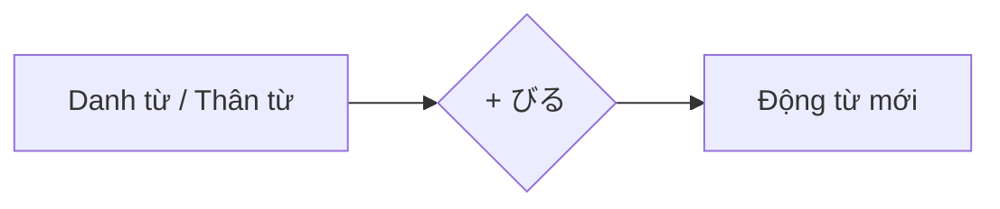

Processing keyword: ～びる (〜biru)
# Điểm ngữ pháp tiếng Nhật: ～びる (〜biru)

## 1. Giới thiệu
Trong bài học này, chúng ta sẽ tìm hiểu sâu về hậu tố ngữ pháp tiếng Nhật **～びる (〜biru)**. Hậu tố này được dùng để tạo thành các động từ diễn đạt "trông giống" hoặc "có đặc điểm của" điều gì đó. Hiểu **～びる** sẽ giúp bạn miêu tả những sắc thái tinh tế về ngoại hình và hành vi trong tiếng Nhật.

---
## 2. Giải thích ngữ pháp cốt lõi
### Ý nghĩa
Hậu tố **～びる** gắn vào một số danh từ hoặc thân từ nhất định để tạo thành các động từ mang nghĩa:
- **Trông giống** (ngoại hình)
- **Có vẻ như**
- **Hành xử như**
- **Mang đặc điểm của**
### Cấu trúc
Cấu trúc cơ bản là:
```
[ Danh từ / Thân từ ] + びる → Động từ mang nghĩa "trông/có vẻ như [Danh từ]"
```
### Sơ đồ cấu tạo

### Ví dụ về cách tạo
| Danh từ/Thân từ        | + びる | Động từ mới       | Ý nghĩa                         |
|------------------|--------|----------------|---------------------------------|
| 大人 (おとな)     | + びる | 大人びる        | Hành xử như người lớn/chín chắn          |
| 古い (ふるい)     | + びる | 古びる          | Trông cũ                     |
| 悪 (わる)        | + びれる| 悪びれる        | Cảm thấy tội lỗi/xấu hổ          |
| 錆 (さび)        | + びる | 錆びる          | Bị gỉ                         |
| 色 (いろ)        | + びる | 色びる          | Trở nên sặc sỡ              |
| 子ども (こども)  | + びる | 子どもびる      | Hành xử trẻ con                 |
*Lưu ý*: Việc dùng **～びる** không áp dụng được với mọi danh từ; nó chủ yếu được dùng với một số từ nhất định.
---
## 3. Phân tích so sánh
### So sánh với các điểm ngữ pháp tương tự
#### **～らしい (〜rashii)**
- **Ý nghĩa**: Có vẻ là, có vẻ như (dựa trên bằng chứng)
- **Cách dùng**: Gắn vào danh từ để tạo thành tính từ
- **Ví dụ**: *彼は大人らしい。* (Anh ấy có vẻ chín chắn.)
#### **～っぽい (〜ppoi)**
- **Ý nghĩa**: Kiểu, giống (chỉ sự giống nhau)
- **Cách dùng**: Gắn vào danh từ, tính từ hoặc động từ để tạo thành tính từ
- **Ví dụ**: *子どもっぽい態度。* (Thái độ trẻ con.)
### Khác biệt chính
- **～びる** tạo thành động từ; **～らしい** và **～っぽい** tạo thành tính từ.
- **～びる** hàm ý việc mang lấy đặc điểm, thường là về hành vi.
- **～っぽい** có thể mang sắc thái tiêu cực, gợi ý điều gì đó mang đặc điểm một cách thái quá hoặc không mong muốn.
---
## 4. Ví dụ trong ngữ cảnh
Hãy xem **～びる** được dùng trong câu như thế nào qua các ngữ cảnh khác nhau.
### Ngữ cảnh trang trọng
1. **その寺は歴史が古く、趣きが古びています。**
   *Ngôi chùa đó có lịch sử lâu đời và trông cổ kính.*
2. **彼の文章は大人びているので、感心しました。**
   *Tôi rất khâm phục vì bài viết của anh ấy rất chín chắn.*
### Ngữ cảnh thân mật
3. **うちの子、最近急に大人びてきたね。**
   *Con nhà tôi dạo này bỗng nhiên hành xử như người lớn nhỉ.*
4. **彼女は年の割に悪びれないね。**
   *Cô ấy không hề thấy ngại dù đã lớn tuổi nhỉ.*
### Ngôn ngữ nói
5. **この服、ちょっと古びてない？**
   *Bộ quần áo này trông hơi lỗi mốt rồi phải không?*
6. **弟が子どもびたことを言って困る。**
   *Em trai tôi nói những điều trẻ con khiến tôi phiền lòng.*
### Ngôn ngữ viết
7. **鉄が錆びてしまったため、交換が必要です。**
   *Vì sắt đã bị gỉ nên cần phải thay thế.*
8. **彼の振る舞いは年齢以上に大人びていた。**
   *Cách cư xử của anh ấy chín chắn hơn so với tuổi.*
---
## 5. Ghi chú văn hóa
### Hiểu về sắc thái
- Dùng **～びる** có thể tinh tế diễn đạt rằng ai đó hoặc điều gì đó đang mang những đặc điểm có thể bất ngờ hoặc không vốn có.
- Ví dụ, một đứa trẻ hành xử như người lớn (**大人びる**) có thể được xem là đáng khâm phục hoặc, tùy ngữ cảnh, là sớm trưởng thành.
### Lịch sự và trang trọng
- Bản thân **～びる** trung tính về mức độ lịch sự.
- Mức độ trang trọng được quyết định bởi ngôn ngữ xung quanh, chẳng hạn như đuôi động từ và kính ngữ.
### Thành ngữ
- **悪びれずに**: *Không biết ngượng; không hối hận.*
  *Ví dụ*: **彼は悪びれずに約束を破った。**
  *Anh ấy phá vỡ lời hứa mà không chút xấu hổ.*
- **古びた**: *Cũ kỹ; cổ lỗ.*
  *Thường dùng để miêu tả những thứ đã cũ nhưng có thể mang giá trị hoài niệm.*
---
## 6. Lỗi thường gặp và mẹo
### Lỗi thường gặp
1. **Khái quát hóa quá mức**
   - **Lỗi**: Cố gắng gắn **～びる** vào bất kỳ danh từ nào.
   - **Sửa**: Chỉ dùng **～びる** với những danh từ mà nó thường kết hợp.
2. **Nhầm lẫn với các hậu tố tương tự**
   - Nhầm lẫn **～びる** với **～ぽい** hoặc **～らしい**.
   - **Mẹo**: Hãy nhớ rằng **～びる** tạo thành động từ, còn **～ぽい** và **～らしい** tạo thành tính từ.
3. **Chia động từ sai**
   - Quên chia **～びる** đúng cách ở các thì khác nhau.
   - **Ví dụ**: **古びます** (hiện tại lịch sự), **古びた** (quá khứ thường), **古びて** (dạng te).
### Mẹo
- **Học các cụm cố định**: Vì **～びる** không áp dụng rộng rãi, hãy tập trung ghi nhớ các động từ thông dụng dùng nó.
  
- **Luyện tập chia động từ**:
  | Động từ         | Hiện tại lịch sự | Quá khứ thường | Dạng te |
  |--------------|----------------|------------|---------|
  | 大人びる     | 大人びます      | 大人びた    | 大人びて |
  | 古びる       | 古びます        | 古びた      | 古びて   |
  | 錆びる       | 錆びます        | 錆びた      | 錆びて   |
- **Tín hiệu ngữ cảnh**: Hãy chú ý đến ngữ cảnh để chọn đúng mẫu ngữ pháp. Nếu miêu tả ngoại hình hoặc hành vi giống với điều gì đó, **～びる** có thể phù hợp.
---
## 7. Tóm tắt và ôn tập
### Điểm chính cần nhớ
- **～びる** là hậu tố dùng để tạo thành các động từ mang nghĩa "trông giống" hoặc "có phẩm chất của" điều gì đó.
- Nó gắn vào các danh từ hoặc thân từ cụ thể.
- Các động từ **～びる** thông dụng gồm **大人びる**, **古びる**, **錆びる**.
  
### Bài kiểm tra nhanh
1. **Điền vào chỗ trống**: "Hành xử như người lớn" trong tiếng Nhật là **大人______**.
   
   **Đáp án**: **びる** (大人**びる**)
2. **Đúng hay Sai**: **～びる** có thể thêm vào bất kỳ danh từ nào để tạo thành động từ.
   
   **Đáp án**: **Sai**
3. **Chọn cách dùng đúng**: Câu nào sau đây dùng đúng **～びる**?
   
   A) *彼は学生びる。*
   B) *彼女は大人びた話し方をする。*
   C) *この料理は辛びる。*
   
   **Đáp án**: **B)** *彼女は大人びた話し方をする。*
---
Bằng cách hiểu và luyện tập **～びる**, bạn sẽ có thể diễn đạt những quan sát tinh tế về ngoại hình và hành vi trong tiếng Nhật!


---

© [Hoangchamchi.org](https://hoangchamchi.org)