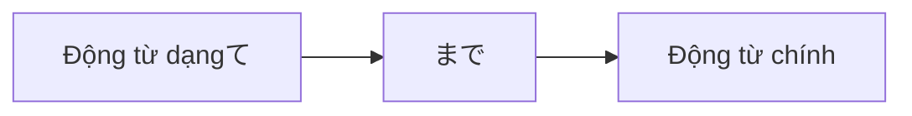

Processing keyword: ～まで～て (〜made 〜te)
# Điểm ngữ pháp tiếng Nhật: ～まで～て (〜made 〜te)

## 1. Giới thiệu
Trong bài học này, chúng ta sẽ tìm hiểu mẫu ngữ pháp tiếng Nhật **～まで～て (〜made 〜te)**. Cấu trúc này được dùng để diễn đạt việc làm mọi thứ đến mức cực đoan hoặc quá mức để đạt được điều gì đó. Nó thường truyền đạt cảm giác làm quá hoặc làm một việc gì đó thái quá để đạt được một kết quả cụ thể.

---
## 2. Giải thích ngữ pháp cốt lõi
### Ý nghĩa
Mẫu **～まで～て** được dùng để chỉ ra rằng ai đó làm điều gì đó **đến mức** hoặc **thậm chí đến mức** của một hành động cực đoan để đạt được mục tiêu. Nó nhấn mạnh mức độ mà một người sẵn sàng làm, đôi khi hàm ý rằng hành động đó là không cần thiết hoặc quá đà.
**Tương đương tiếng Anh:**
- "Đi xa đến mức..."
- "Thậm chí đến mức..."
- "Đến mức..."
### Cấu trúc
Cấu trúc của điểm ngữ pháp này là:
#### **Động từ dạngて + まで + Động từ**
| Thành phần          | Vai trò                                  |
|--------------------|---------------------------------------|
| **Động từ dạngて**     | Hành động cực đoan được thực hiện                  |
| **まで**            | Trợ từ chỉ "đến mức" |
| **Động từ chính**      | Hành động hoặc mục tiêu chính                |
### Sơ đồ cấu tạo

---
## 3. Phân tích so sánh
### So sánh với các điểm ngữ pháp tương tự
- **～てでも**: Chỉ việc làm điều gì đó không mong muốn nhưng cần thiết để đạt được mục tiêu.
  - **Ví dụ**: 会えないなら、借金してでも行く。
    *Nếu không gặp được bạn, tôi sẽ đi dù phải vay tiền.*
- **～までも**: Diễn đạt "đến mức" nhưng thường dùng với danh từ.
  - **Ví dụ**: 命までも捧げる。
    *Tôi sẽ hiến dâng cả mạng sống.*
Trong khi **～てでも** tập trung vào sự sẵn sàng làm điều không mong muốn, **～まで～て** nhấn mạnh mức độ cực đoan mà một người làm, thường làm nổi bật sự thái quá.
---
## 4. Ví dụ trong ngữ cảnh
### Ví dụ câu
1. **彼は借金してまで新車を買った。**
   *Kare wa shakkin shite made shinsha o katta.*
   - **Bản dịch**: Anh ấy đã đi xa đến mức vay tiền để mua xe mới.
2. **彼女は嘘をついてまで彼を守った。**
   *Kanojo wa uso o tsuite made kare o mamotta.*
   - **Bản dịch**: Cô ấy bảo vệ anh ấy thậm chí đến mức nói dối.
3. **健康を害してまで働く必要はない。**
   *Kenkō o gaishite made hataraku hitsuyō wa nai.*
   - **Bản dịch**: Không cần thiết phải làm việc đến mức hại sức khỏe.
4. **名誉を失ってまで成功したくない。**
   *Meiyo o ushinatte made seikō shitakunai.*
   - **Bản dịch**: Tôi không muốn thành công nếu điều đó có nghĩa là mất danh dự.
5. **徹夜してまでこのゲームをクリアしたい。**
   *Tetsuya shite made kono gēmu o kuria shitai.*
   - **Bản dịch**: Tôi muốn vượt qua trò chơi này dù phải thức trắng đêm.
### Cách dùng theo ngữ cảnh
- **Viết trang trọng**
  - **環境を破壊してまで経済成長を求めるべきではない。**
    *Kankyō o hakai shite made keizai seichō o motomeru beki dewa nai.*
    - Chúng ta không nên tìm kiếm tăng trưởng kinh tế đến mức phá hủy môi trường.
- **Nói thân mật**
  - **徹夜してまで勉強するなんて、無理しないで。**
    *Tetsuya shite made benkyō suru nante, muri shinai de.*
    - Đừng cố quá sức bằng cách học đến mức thức trắng đêm.
---
## 5. Ghi chú văn hóa
### Sự liên quan về văn hóa
Trong văn hóa Nhật Bản, sự điều độ và cân bằng được coi trọng. Dùng **～まで～て** làm nổi bật những hành động vượt quá ranh giới bình thường, thường bị xem là thái quá hoặc không cần thiết. Nó có thể mang sắc thái tiêu cực, gợi ý rằng hành động đó có thể không nên làm về mặt xã hội hoặc cá nhân.
### Mức độ lịch sự
Mẫu ngữ pháp này có thể dùng trong cả hội thoại lịch sự và thân mật, nhưng ngữ cảnh thường quyết định mức độ trang trọng. Trong lời nói viết và trang trọng, nó được dùng để bàn về những vấn đề nghiêm túc, còn trong lời nói thân mật, nó được dùng để bày tỏ sự quan ngại hoặc phóng đại.
### Thành ngữ
- **死んでまで**
  *Shinde made*
  - **Bản dịch**: Đến mức chết.
  - **Cách dùng**: **死んでまで守りたいものがある。**
    *Có những điều tôi muốn bảo vệ dù phải chết.*
---
## 6. Lỗi thường gặp và mẹo
### Phân tích lỗi
1. **Dùng dạng thường thay vì dạngて**
   - **Sai**: 借金するまで新車を買った。
   - **Đúng**: 借金してまで新車を買った。
     *Dùng dạngて của động từ trước まで.*
2. **Đặt sai vị trí まで**
   - **Sai**: 彼はまで借金して新車を買った。
   - **Đúng**: 彼は借金してまで新車を買った。
     *まで theo sau dạngて của động từ.*
### Chiến lược học tập
- **Thủ thuật ghi nhớ**
  - Hãy nghĩ **Động từ dạngて + まで** như "làm [Động từ] đến mức..."
- **Gợi nhớ trực quan**
  - Liên hệ **まで** với một cột mốc hoặc giới hạn, nhấn mạnh mức độ đạt được.
---
## 7. Tóm tắt và ôn tập
### Điểm chính cần nhớ
- **～まで～て** diễn đạt việc làm mọi thứ đến mức cực đoan để làm điều gì đó.
- Cấu trúc: **Động từ dạngて + まで + Động từ chính**
- Truyền đạt cảm giác thái quá hoặc hành động không cần thiết.
### Bài kiểm tra nhanh
1. **Điền dạng đúng vào chỗ trống:**
   健康を________まで働く意味があるのか。
   - **Đáp án**: **害して**
2. **Dịch câu sau:**
   **彼はリスクを冒してまでそのプロジェクトに参加した。**
   - **Đáp án**: Anh ấy đã tham gia dự án đó dù phải chấp nhận rủi ro.
3. **Đúng hay Sai:**
   Mẫu ngữ pháp **～まで～て** được dùng để diễn đạt các hành động điều độ.
   - **Đáp án**: Sai (Nó diễn đạt các hành động cực đoan hoặc thái quá.)
---
Bằng cách hiểu **～まで～て**, bạn có thể diễn đạt mức độ mà ai đó sẵn sàng làm để đạt được điều gì đó, thêm chiều sâu và sắc thái cho kỹ năng giao tiếp tiếng Nhật của bạn.

---

© [Hoangchamchi.org](https://hoangchamchi.org)