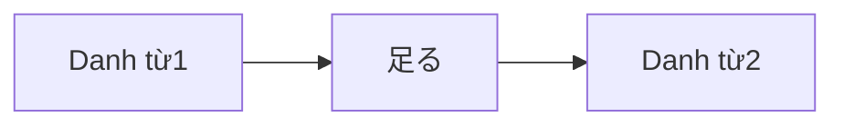

Processing keyword: ～足る Noun (〜taru～)
# Điểm ngữ pháp tiếng Nhật: ～足る Noun (〜taru～)

## 1. Giới thiệu
Trong bài học này, chúng ta sẽ tìm hiểu điểm ngữ pháp **～足る (〜たる)**, một biểu thức trang trọng được dùng trong tiếng Nhật để chỉ sự xứng đáng hoặc phù hợp. Cấu trúc này nhấn mạnh rằng ai đó hoặc điều gì đó sở hữu những phẩm chất cần thiết cho một vai trò hoặc địa vị cụ thể.

---
## 2. Giải thích ngữ pháp cốt lõi
### Ý nghĩa
Cụm từ **～足る Noun** mang nghĩa "xứng đáng là ~" hoặc "phù hợp cho ~". Nó làm nổi bật rằng chủ thể có những phẩm chất hoặc địa vị xứng với danh từ theo sau.
### Cấu trúc
```plaintext
Danh từ1 + 足る + Danh từ2
```
- **Danh từ1**: Thực thể sở hữu những phẩm chất.
- **足る (たる)**: Một động từ cổ mang nghĩa "xứng đáng" hoặc "đủ cho".
- **Danh từ2**: Vai trò hoặc địa vị được trao.
### Sơ đồ cấu tạo
| Thành phần | Chức năng                                |
|-----------|-----------------------------------------|
| Danh từ1     | Chủ thể có phẩm chất                  |
| 足る      | Chỉ sự xứng đáng/phù hợp         |
| Danh từ2     | Vai trò hoặc địa vị mà chủ thể xứng đáng |
---
### Hình ảnh minh họa

---
## 3. Phân tích so sánh
### So sánh với các biểu thức tương tự
- **～にふさわしい Noun**
  - **Ý nghĩa**: "Danh từ phù hợp cho ~", "thích hợp cho ~".
  - **Cách dùng**: Phổ biến hơn trong hội thoại hằng ngày.
  - **Ví dụ**: 
    - 彼はリーダーにふさわしい人物だ。  
      *Anh ấy là một người phù hợp để làm trưởng nhóm.*
- **～に値する (〜にあたいする)**
  - **Ý nghĩa**: "Đáng ~", "xứng đáng ~".
  - **Cách dùng**: Có thể dùng trong cả ngữ cảnh trang trọng và thân mật.
  - **Ví dụ**: 
    - 彼の行動は尊敬に値する。  
      *Hành động của anh ấy đáng được tôn trọng.*
**Khác biệt**:
- **～足る** trang trọng hơn và thường được dùng trong ngôn ngữ viết hoặc bài phát biểu.
- Nó mang hàm ý mạnh hơn về sự xứng đáng hoặc đủ tư cách vốn có.
---
## 4. Ví dụ trong ngữ cảnh
### Ví dụ câu
1. **教師足る者、常に学ぶ姿勢を持つべきだ。**  
   *きょうしたるもの、つねにまなぶしせいをもつべきだ。*  
   *Một người xứng đáng làm giáo viên nên luôn có thái độ ham học hỏi.*
2. **彼は信頼するに足る人物だ。**  
   *かれはしんらいするにたるじんぶつだ。*  
   *Anh ấy là một người đáng tin cậy.*
3. **この作品は賞賛に足る出来栄えだ。**  
   *このさくひんはしょうさんにたるできばえだ。*  
   *Tác phẩm này có chất lượng xứng đáng được khen ngợi.*
4. **彼女はリーダー足る資質を備えている。**  
   *かのじょはリーダーたるししつをそなえている。*  
   *Cô ấy sở hữu những phẩm chất xứng đáng làm trưởng nhóm.*
5. **政治家足る者、公正であるべきだ。**  
   *せいじかたるもの、こうせいであるべきだ。*  
   *Những người xứng đáng làm chính trị gia nên công bằng.*
---
### Cách dùng theo ngữ cảnh
- **Các tình huống trang trọng**: Được dùng trong các bài phát biểu trang trọng, văn bản và thảo luận về vai trò và trách nhiệm.
- **Nhấn mạnh tiêu chuẩn**: Làm nổi bật các tiêu chuẩn hoặc phẩm chất cao được mong đợi ở một người trong một vai trò cụ thể.
---
## 5. Ghi chú văn hóa
### Sự liên quan về văn hóa
Trong văn hóa Nhật Bản, sự nhấn mạnh lớn được đặt vào việc hoàn thành vai trò của mình với những phẩm chất và hành vi phù hợp. Dùng **～足る** nhấn mạnh tầm quan trọng của việc đáp ứng các kỳ vọng xã hội liên quan đến các vị trí nhất định.
### Mức độ lịch sự và trang trọng
- **Biểu thức trang trọng**: Không thường được dùng trong trò chuyện thân mật.
- **Phù hợp trong văn viết**: Thích hợp cho bài luận, thư trang trọng và bài phát biểu.
### Thành ngữ
- **勇気ある者足るべし**  
  *(Người ta nên xứng đáng được gọi là dũng cảm.)*
- **紳士足る態度**  
  *(Một thái độ xứng đáng với một quý ông.)*
---
## 6. Lỗi thường gặp và mẹo
### Phân tích lỗi
1. **Dùng trong các ngữ cảnh thân mật**
   - **Lỗi**: Dùng **～足る** trong trò chuyện thân mật có thể nghe không tự nhiên.
   - **Sửa**: Dùng các biểu thức phổ biến hơn như **～にふさわしい**.
   - **Ví dụ**: 
     - Thân mật: **彼は信頼するに足る友達だ。** (Quá trang trọng)
     - Tốt hơn: **彼は信頼できる友達だ。** (Anh ấy là một người bạn đáng tin cậy.)
2. **Cấu trúc sai**
   - **Lỗi**: Đặt sai vị trí **足る** hoặc dùng sai dạng.
   - **Sửa**: Đảm bảo **足る** trực tiếp theo sau **Danh từ1**.
   - **Ví dụ**: 
     - Sai: **足る教師者、学生の模範だ。**
     - Đúng: **教師足る者、学生の模範だ。**
### Chiến lược học tập
- **Liên tưởng**: Kết nối **足る** với "đủ hoặc xứng đáng" để nhớ ý nghĩa của nó.
- **Luyện tập các ngữ cảnh trang trọng**: Đọc các văn bản tiếng Nhật trang trọng để xem cách **～足る** được dùng.
- **Dùng các cụm cố định**: Ghi nhớ các biểu thức phổ biến như **信頼するに足る** để làm quen với mẫu.
---
## 7. Tóm tắt và ôn tập
### Điểm chính cần nhớ
- **～足る Noun** là một biểu thức trang trọng mang nghĩa "xứng đáng là ~" hoặc "phù hợp cho ~".
- **Cấu trúc**: **Danh từ1 + 足る + Danh từ2**
- Nhấn mạnh sự phù hợp hoặc đủ tư cách của chủ thể cho một vai trò.
- Thường được dùng trong văn viết và bài phát biểu trang trọng.
- Không thường được dùng trong hội thoại hằng ngày.
---
### Bài kiểm tra nhanh
1. **Điền vào chỗ trống**
   この作品は賞賛に ____ 出来栄えだ。  
   *(Tác phẩm này có chất lượng xứng đáng được khen ngợi.)*
   **Đáp án**: 足る
2. **Đúng hay Sai**
   **～足る** thường được dùng trong trò chuyện thân mật giữa bạn bè.
   **Đáp án**: Sai
3. **Chọn cách dùng đúng**
   Câu nào dùng đúng **～足る**?
   a) 彼は学生足りる者だ。  
   b) 彼は学生足る者だ。  
   c) 彼は学生に足る者だ。
   **Đáp án**: b) 彼は学生足る者だ。
---
Bằng cách hiểu **～足る Noun**, bạn nâng cao khả năng đọc và hiểu các văn bản tiếng Nhật trang trọng và diễn đạt những ý tưởng tinh tế về sự xứng đáng và phù hợp trong các ngữ cảnh thích hợp.


---

© [Hoangchamchi.org](https://hoangchamchi.org)